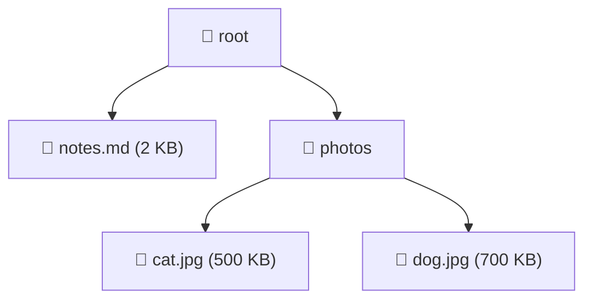
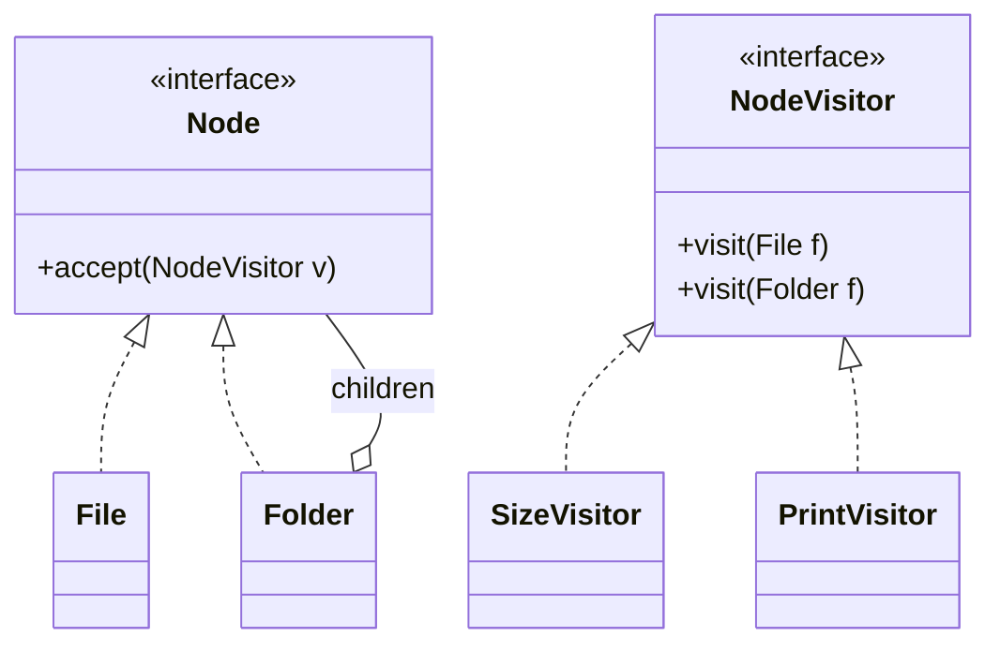
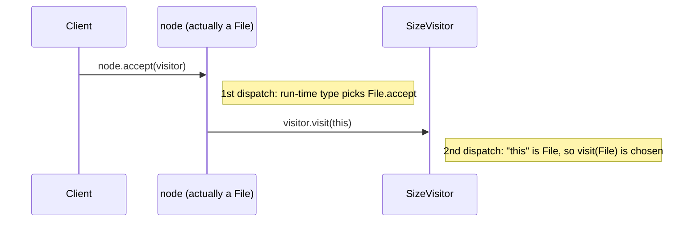

[[Session 10 - DesignPatternsII.pdf]]

---

# Design Patterns II: The Visitor Pattern

> [!summary] TL;DR
> 
> - **Visitor** is a _behavioral_ pattern that **separates algorithms from the objects they operate on**.
> - Typical starting point: a **composite structure** (list, tree, graph) of **different kinds of elements**.
> - Instead of adding a new method to every element class for each new feature, you write a new **Visitor** class that "visits" each element.
> - Mechanism: each element has one `accept(visitor)` method that calls `visitor.visit(this)`, so the right `visit` overload runs (**double dispatch**).

Previous: [[Lecture 9]]

---

## 1. Recap

A **design pattern** is a blueprint for a recurring problem, with a **name**, an **intent** and a **specific problem** it solves. Full catalogue in [[OOP Lecture 9 - Design Patterns#2. Catalogue of Patterns|Lecture 9]].

|Covered so far|Category|
|---|---|
|Builder|Creational|
|Decorator|Structural|
|Observer, Strategy|Behavioral|
|**Visitor** ← today|Behavioral|

---

## 2. The Visitor Pattern

> [!important] Visitor **Purpose:** Define **new functionality** without modifying an existing class.
> 
> **Starting point:** usually a **composite class**: a list, tree, graph, etc. made of **different kinds of elements**.
> 
> **Problem:** We want to implement new features by **traversing the elements**, but we can't (or don't want to) keep adding code to the composite/element classes.
> 
> **Solution:** Implement **different ways of visiting** the elements as separate Visitor classes. No new code goes into the composite class for each feature.

> [!quote] One-liner Visitor lets you separate algorithms from the objects on which they operate.

---

## 3. The Problem (my example)

A file system: a **tree** of `File`s and `Folder`s (a Folder contains other files/folders, which is the _Composite_ pattern).



Features we want:

- compute the **total size**
- **print** the tree
- **count** the files
- **search** by name
- export to JSON, …

### The naive approach: a method per feature in every class

```java
interface Node {
    long totalSize();
    void print();
    int countFiles();
    // ...one more method for EVERY new feature
}
```

> [!question] What's wrong?
> 
> - Every new feature means **editing every element class**.
> - Element classes fill up with unrelated logic (size, printing, JSON, …), which breaks "one class, one responsibility" ([[OOP Lecture 2 - Classes, Packages, Encapsulation#5. What Goes in a Class?|Lecture 2]]).
> - Sometimes you **can't** edit the classes at all (library code).

---

## 4. The Visitor Solution

### Roles

|Role|Job|
|---|---|
|**Element interface**|Declares one method: `accept(Visitor v)`|
|**Concrete elements** (`File`, `Folder`)|Implement `accept` by calling `v.visit(this)`|
|**Visitor interface**|One `visit` method **per element type**|
|**Concrete visitors**|One class **per feature** (size, print, …)|



### Step 1: The visitor interface (one `visit` per element type)

```java
public interface NodeVisitor {
    void visit(File file);
    void visit(Folder folder);
}
```

### Step 2: The elements, with `accept` added once

```java
public interface Node {
    void accept(NodeVisitor visitor); // the ONLY method needed for any number of features
}

public class File implements Node {
    private final String name;
    private final long size; // in KB

    public File(String name, long size) {
        this.name = name;
        this.size = size;
    }

    public String getName() { return name; }
    public long getSize()   { return size; }

    @Override
    public void accept(NodeVisitor visitor) {
        visitor.visit(this); // "this" is a File → calls visit(File)
    }
}

public class Folder implements Node {
    private final String name;
    private final List<Node> children = new ArrayList<>();

    public Folder(String name) { this.name = name; }

    public void add(Node child)      { children.add(child); }
    public String getName()          { return name; }
    public List<Node> getChildren()  { return children; }

    @Override
    public void accept(NodeVisitor visitor) {
        visitor.visit(this); // "this" is a Folder → calls visit(Folder)
    }
}
```

### Step 3: Features as visitors

```java
// Feature 1: total size
public class SizeVisitor implements NodeVisitor {
    private long total = 0;                    // the visitor keeps its own state

    @Override
    public void visit(File file) {
        total += file.getSize();               // a file contributes its size
    }

    @Override
    public void visit(Folder folder) {
        for (Node child : folder.getChildren()) {
            child.accept(this);                // traverse into each child
        }
    }

    public long getTotal() { return total; }
}

// Feature 2: print the tree with indentation
public class PrintVisitor implements NodeVisitor {
    private int depth = 0;

    @Override
    public void visit(File file) {
        System.out.println("  ".repeat(depth) + "📄 " + file.getName());
    }

    @Override
    public void visit(Folder folder) {
        System.out.println("  ".repeat(depth) + "📁 " + folder.getName());
        depth++;                               // children are indented one more level
        for (Node child : folder.getChildren()) {
            child.accept(this);
        }
        depth--;
    }
}
```

### Step 4: Using it

```java
Folder root = new Folder("root");
root.add(new File("notes.md", 2));
Folder photos = new Folder("photos");
photos.add(new File("cat.jpg", 500));
photos.add(new File("dog.jpg", 700));
root.add(photos);

SizeVisitor size = new SizeVisitor();
root.accept(size);
System.out.println(size.getTotal() + " KB"); // 1202 KB

root.accept(new PrintVisitor());
// 📁 root
//   📄 notes.md
//   📁 photos
//     📄 cat.jpg
//     📄 dog.jpg
```

> [!tip] Adding a third feature Counting files = **one new class** (`CountVisitor`). `File`, `Folder` and `Node` don't change at all.

---

## 5. Why `accept`? Double Dispatch

> [!question] Why not just call `visitor.visit(node)` directly?
> 
> ```java
> Node node = new File("a.txt", 1);
> visitor.visit(node); // ❌ compile error: there's no visit(Node), only visit(File) and visit(Folder)
> ```
> 
> Java picks an **overload** based on the **compile-time type** (`Node`), not the run-time type (`File`). It doesn't know which `visit` to call.

`accept` solves this in two steps:



1. `node.accept(v)`: **dynamic dispatch** picks `File.accept` because the object really is a `File` (normal polymorphism, [[OOP Lecture 3 - Interfaces and Inheritance#3. Subtyping & Polymorphism|Lecture 3]]).
2. Inside `File.accept`, `this` has static type `File`, so `v.visit(this)` picks `visit(File)`.

> [!important] Double dispatch The method that runs depends on **two** run-time types: the **element** _and_ the **visitor**. That's the trick that makes Visitor work.

---

## 6. Trade-offs

|✅ Easy|❌ Hard|
|---|---|
|Adding a **new operation** → one new visitor class|Adding a **new element type** → add a `visit` method to **every** visitor|
|Related logic lives together (all "size" code in `SizeVisitor`)|Visitors often need **getters** on elements, which weakens encapsulation|
|Element classes stay small and focused|More classes and indirection; harder to follow at first|

> [!note] "No code added to the composite class" The slides say no code is added to the composite class. More precisely: you add `accept` **once**, and after that, **no** code is added for each new feature.

> [!tip] When to use Visitor ✅ The set of **element types is stable** (rarely changes), but you keep adding **new operations**. ❌ New element types are added often → every visitor breaks each time.

Classic real-world uses: **compilers** (visiting the syntax tree to type-check, optimize, generate code), document exporters (HTML/PDF/Markdown), file-system walkers (Java's own `FileVisitor` in `java.nio.file`).

---

## 7. Bonus: Visitors That Return Values (generic)

Instead of storing results in fields, make the visitor generic ([[OOP Lecture 6 - Collections, Object Class, Generics#17. Parametric Polymorphism (Generics)|Lecture 6]]):

```java
public interface NodeVisitor<R> {     // R = result type
    R visit(File file);
    R visit(Folder folder);
}

public interface Node {
    <R> R accept(NodeVisitor<R> visitor);
}

// in File:   public <R> R accept(NodeVisitor<R> v) { return v.visit(this); }
// in Folder: public <R> R accept(NodeVisitor<R> v) { return v.visit(this); }

public class SizeVisitor implements NodeVisitor<Long> {
    public Long visit(File file) {
        return file.getSize();
    }
    public Long visit(Folder folder) {
        long sum = 0;
        for (Node child : folder.getChildren()) {
            sum += child.accept(this);     // recursion returns each child's size
        }
        return sum;
    }
}

long total = root.accept(new SizeVisitor()); // 1202
```

---

## 8. Bonus: Modern Java Alternative

Java 21 can do much of this with **sealed interfaces** and **pattern-matching `switch`**, without `accept`:

```java
sealed interface Node permits File, Folder {}
record File(String name, long size) implements Node {}
record Folder(String name, List<Node> children) implements Node {}

static long size(Node node) {
    return switch (node) {                 // compiler checks every case is covered
        case File f   -> f.size();
        case Folder d -> d.children().stream().mapToLong(c -> size(c)).sum();
    };
}
```

> [!info] Same trade-off Adding a new operation = a new method. Adding a new element type = the compiler flags every `switch` that's now missing a case. Know the classic Visitor for the course; this is just good to recognize.

---

## Key Terms

- **Visitor pattern** – behavioral pattern separating operations from the objects they act on
- **Element** – an object in the structure that can be visited (has `accept`)
- **Visitor** – an object with one `visit` method per element type; one visitor = one feature
- **`accept(visitor)`** – element method that calls `visitor.visit(this)`
- **Composite** – structure where containers hold elements (and other containers), e.g. trees
- **Traversal** – walking through every element of a structure
- **Overloading** – several methods with the same name but different parameter types; chosen at compile time
- **Dynamic dispatch** – choosing a method implementation by the object's run-time type
- **Double dispatch** – choosing behavior based on two run-time types (element + visitor)