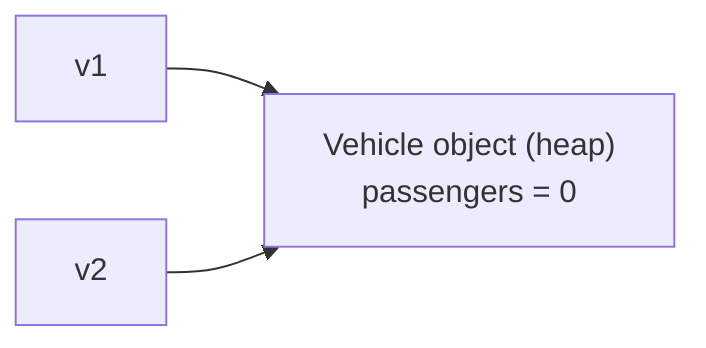

---

## course: OOP lecture: 2 lecturer: Magnus Madsen topics: [classes, objects, constructors, garbage-collection, packages, encapsulation, access-modifiers] tags: [oop, java, lecture]

# OOP Lecture 2 – Classes, Packages & Encapsulation

> [!summary] TL;DR
> 
> - A **class** is a blueprint; an **object** is an instance of it, created with `new` and living on the heap.
> - Variables hold **references** to objects, so `=` copies the arrow, not the object.
> - **Packages** group classes and prevent name clashes (`java.lang.String`).
> - **Encapsulation**: make fields `private`, change state only through methods that protect the object's rules.

---

## 1. Programming Paradigms

|Procedural (e.g. C)|Object-Oriented (e.g. Java)|
|---|---|
|Organized around **actions**|Organized around **things**|
|withdraw, deposit, transfer|customer, money, account|

---

## 2. Classes and Objects

### Class

A **template** that defines the form of an object.

- Specifies both **data** and **code**.
- Members = **fields** (a.k.a. _instance variables_) + **methods**.
- Does not exist at run-time (for this course's purposes).

### Object

A **value** that exists at run-time.

- An **instance** of a class.
- Created (allocated) with `new`.
- Destroyed (deallocated) automatically by [[#Garbage Collection]].

### Basic structure

```java
class ClassName {
    // fields
    type field1;
    type field2;

    // methods
    type method1(params...) {
        // method body
    }
}
```

### Example: Vehicle

```java
class Vehicle {
    int passengers; // number of passengers
    int fuelcap;    // fuel capacity in gallons
    int mpg;        // miles per gallon
}

Vehicle minivan = new Vehicle(); // object allocated on the heap
minivan.passengers = 7;
minivan.fuelcap = 16;
minivan.mpg = 21;

Vehicle sportscar = new Vehicle(); // a SEPARATE object
sportscar.passengers = 2;
sportscar.fuelcap = 14;
sportscar.mpg = 12;

int minivanRange = minivan.fuelcap * minivan.mpg;       // 336 miles
int sportscarRange = sportscar.fuelcap * sportscar.mpg; // 168 miles
```

> [!info] Each object has its own copy of the fields `minivan` and `sportscar` are two different objects on the heap with independent values.

---

## 3. References and Aliasing

A variable doesn't _contain_ an object, it _points to_ one.

```java
Vehicle v1 = new Vehicle();
v1.passengers = 7;

Vehicle v2 = v1;   // copies the REFERENCE, not the object
v2.passengers = 0; // v1.passengers is now 0 too!
```



> [!warning] Exam trap `v1` and `v2` are **aliases**: two names for the same object. Changing it through one is visible through the other.

---

## 4. Methods

Methods are behavior that uses the object's own data.

```java
class Vehicle {
    int passengers;
    int fuelcap;
    int mpg;

    double fuelNeeded(int miles) {
        return (double) miles / (double) this.mpg; // explicit "this"
    }

    double fuelNeeded2(int miles) {
        return (double) miles / (double) mpg;      // equivalent: "this" is implied
    }
}
```

> [!tip] `this` `this` refers to the current object. `mpg` and `this.mpg` mean the same thing unless a parameter/local variable has the same name (then `this.` is required to reach the field).

---

## 5. What Goes in a Class?

- One class = **one logical entity** (vehicle, fruit, tennis player, ticket, stadium…).
- It captures **data and behavior related to that entity**.
    - A ticket has a price and a purchase date.
- It should have **as little responsibility as possible**.
    - A `Vehicle` may compute fuel consumption ✅
    - A `Vehicle` should **not** compute the distance between two cities ❌
- If a class's responsibilities grow too large, it should **delegate** to other classes.

---

## 6. Constructors

A **special method** called when an object is created.

- Same name as the class, **no return type**.
- A class comes with a **default empty constructor**, which disappears once you write your own.
- Used to control how objects are created.

```java
class Vehicle {
    int passengers;
    int fuelcap;
    int mpg;

    Vehicle(int p, int f, int m) {
        this.passengers = p;
        this.fuelcap = f;
        this.mpg = m;
    }
}

Vehicle minivan = new Vehicle(7, 16, 21); // all fields set in one line
```

### Multiple constructors (overloading)

Allowed as long as the **parameter lists differ**.

```java
Vehicle(int f, int m) {
    this.passengers = 5; // default value
    this.fuelcap = f;
    this.mpg = m;
}

Vehicle(int p, int f, int m) {
    this.passengers = p;
    this.fuelcap = f;
    this.mpg = m;
}
```

---

## 7. Garbage Collection

- Objects are allocated with `new`, but you never free them manually.
- The **JVM automatically deallocates** objects that are no longer used.
- An object is "no longer used" when there are **no live references** to it.

```java
Vehicle v1 = new Vehicle(40, 20);
Vehicle v2 = new Vehicle(60, 30);
v1 = v2; // the first Vehicle has no references left → eligible for GC
```

---

## 8. Packages

A **package** is a named collection of classes and interfaces.

- Dotted name, e.g. `foo.bar.baz`.
- The empty name = the **default (root) package**.

|Package|Class|Fully qualified name|
|---|---|---|
|`java.lang`|`String`|`java.lang.String`|
|`java.net`|`Socket`|`java.net.Socket`|

### Why packages?

- Distinguish two concepts with the **same name** (swimming `Pool` vs. billiards `Pool`).
- **Reuse** the same name for different things.
- Allow **different implementations** of the same concept.
- **Organize** large collections of classes.

### Standard library examples

- `java.io` – input/output: `BufferedReader`, `BufferedWriter`, `File`, `FileReader`, `FileWriter`, …
- `java.time` – time: `Clock`, `Duration`, `Instant`, `LocalDate`, `LocalDateTime`, `LocalTime`, …

### Naming convention

Use **reversed domain names** as prefixes:

- `org.junit.jupiter.api`
- `org.apache.logging.log4j`
- `dk.aau.cs.yourpackage`

> [!info] Why reversed domains? A domain has an owner and shows affiliation, so it's a simple way to avoid name clashes.

---

## 9. Encapsulation

### The problem

```java
class BankAccount {
    int balance; // NOT private: anyone can change it

    BankAccount(int balance) {
        this.balance = balance;
    }

    boolean withdraw(int amount) {
        if (amount <= this.balance) {
            this.balance = this.balance - amount;
            return true;
        }
        return false;
    }
}

// Somewhere else...
BankAccount account = new BankAccount(100);
account.withdraw(75);      // follows the rules
account.balance = 500_000; // Bob bypasses the rules entirely 😈
```

We want accounts to satisfy **invariants** (rules that must always hold):

- An account cannot be overdrawn.
- A withdrawal is always deducted from the balance.
- A receipt is always printed when a withdrawal is made.

**Goal:** principled access to the state of an object.

### Key idea

> [!important] Encapsulation
> 
> - All **state** of an object should be **private** (inaccessible to the outside world).
> - **Mutation** should only be possible through **methods** that ensure the integrity of the state.
> 
> _State = the values of the object's fields._

### The fix

```java
class BankAccount {
    private int balance; // only this class can touch it

    BankAccount(int balance) {
        this.balance = balance;
    }

    // The ONLY way to reduce the balance, and it checks the rule
    boolean withdraw(int amount) {
        if (amount <= this.balance) {
            this.balance = this.balance - amount;
            return true;  // success
        }
        return false;     // insufficient funds
    }
}
```

> [!bug] Slide error The "Example" slide declares `withdraw` as returning `int` but returns `true`/`false`. That won't compile; the return type should be `boolean`.

---

## 10. Access Modifiers

|Modifier|Class|Package|Subclass|World|
|---|:-:|:-:|:-:|:-:|
|`public`|✅|✅|✅|✅|
|`protected`|✅|✅|✅|❌|
|_(no modifier)_|✅|✅|❌|❌|
|`private`|✅|❌|❌|❌|

> [!tip] Golden rule Everything should have the **least visibility** possible. **Corollary:** everything should be `private` by default.

---

## 11. Getters and Setters

Controlled access to private fields.

```java
class Person {
    private String name;
    private int age;

    public String getName() { // read-only: there is no setName
        return this.name;
    }

    public int getAge() {
        return this.age;
    }

    public void setAge(int age) {
        if (age >= 0) {       // the setter can reject invalid values
            this.age = age;
        }
    }
}
```

> [!note] Leaving out a setter is a design choice `Person` has no `setName`, so the name can't change after creation.

### Why getters? The Temperature example

```java
class Temperature {
    private int celsius;

    public int getKelvin()     { return celsius + 273; }
    public int getCelsius()    { return celsius; }
    public int getFahrenheit() { return celsius * 9 / 5 + 32; }
}
```

> [!question] What would happen if the program used the `celsius` field directly? All outside code would depend on **how** the class stores the temperature. If you later decided to store it in Kelvin instead, every piece of code reading `celsius` would break or silently give wrong results.
> 
> With getters, you only update the methods **inside** the class; callers of `getCelsius()`, `getKelvin()` and `getFahrenheit()` never notice. → Encapsulation lets you change **how it works** without changing **how it's used**.

---

## Key Terms

- **Class** – blueprint defining fields and methods
- **Object / instance** – a run-time value created from a class with `new`
- **Field / instance variable** – data stored in each object
- **Method** – behavior defined in a class
- **Constructor** – special method run on object creation
- **Reference** – a pointer to an object on the heap
- **Aliasing** – two variables referring to the same object
- **Garbage collection** – automatic deallocation of unreferenced objects
- **Package** – named collection of classes (`java.util`)
- **Fully qualified name** – package + class (`java.lang.String`)
- **Encapsulation** – private state + controlled access via methods
- **Invariant** – a rule about an object's state that must always hold
- **Access modifier** – `public`, `protected`, (none), `private`