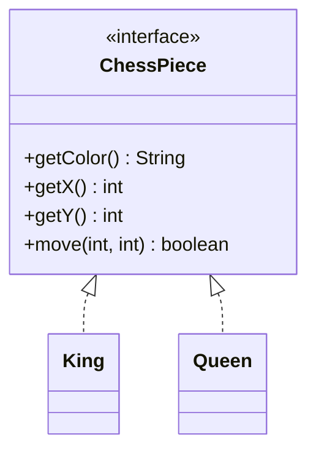
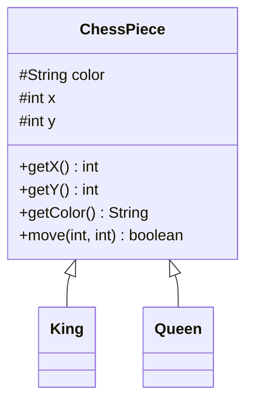

[[Session 3 - Interfaces  Inheritance.pdf]]

# Interfaces & Inheritance

> [!summary] TL;DR
> 
> - An **interface** is a contract: a list of method signatures that implementing classes must provide.
> - A class that `implements` an interface is a **subtype** of it, so it can be used wherever the interface is expected.
> - **Inheritance** (`extends`) lets a subclass reuse fields and methods from a superclass, removing duplication.
> - An **abstract class** sits in between: it can have fields and implemented methods _and_ unimplemented (`abstract`) ones.

Previous: [[Software Engineer/3 Semester/OOP/Notes/Lecture 2|Lecture 2]]

---

## 1. Starting Point: One ChessPiece Class

```java
public class ChessPiece {
    private String type;  // "King", "Queen", ... stored as a string
    private String color;
    private int x;
    private int y;

    public String getColor() { return color; }
    public int getX() { return x; }
    public int getY() { return y; }

    public boolean move(int newX, int newY) {
        // must handle the rules of EVERY piece type here...
    }
}
```

> [!question] What's wrong with this? `move` would need a giant `if/switch` on `type` to handle the rules for every piece. Each piece is a different logical entity with different behavior, so this one class has too much responsibility (see [[OOP Lecture 2 - Classes, Packages, Encapsulation#5. What Goes in a Class?|What goes in a class?]]).

---

## 2. Interfaces

An **interface** introduces an abstraction for a logical entity.

- It is a collection of **method signatures** (no bodies).
- It is **implemented** by one or more classes.
- Each implementing class **must implement all** the interface's methods.
- A class that implements an interface is a **subtype** of that interface.
- An interface **cannot be instantiated** by itself (`new ChessPiece()` is illegal).

```java
interface ChessPiece {
    String getColor();
    int getX();
    int getY();
    boolean move(int newX, int newY); // just the signature, no body
}
```

### Implementing it

```java
class King implements ChessPiece {
    public String getColor() { ... }
    public int getX() { ... }
    public int getY() { ... }

    public boolean move(int newX, int newY) {
        // the rules for a King: one square in any direction
    }
}

class Queen implements ChessPiece {
    public String getColor() { ... }
    public int getX() { ... }
    public int getY() { ... }

    public boolean move(int newX, int newY) {
        // the rules for a Queen: any distance, straight or diagonal
    }
}
```

> [!bug] Slide error: missing `public` Interface methods are implicitly `public`. The slides implement them with no modifier (package-private), which **reduces visibility** and won't compile. Implementing methods must be `public`.

---

## 3. Subtyping & Polymorphism

Because `King` and `Queen` are subtypes of `ChessPiece`, they can be stored in a `ChessPiece` variable and passed to any method that takes a `ChessPiece`.

```java
public class Main {
    public static void main(String[] args) {
        ChessPiece king = new King("Black");   // static type: ChessPiece
        ChessPiece queen = new Queen("Black"); // actual object: Queen

        tryMove(king, 1, 1);  // calls King's move rules
        tryMove(queen, 1, 1); // calls Queen's move rules
    }

    // Works for ANY ChessPiece, including ones written later (Rook, Knight...)
    private static void tryMove(ChessPiece piece, int x, int y) {
        if (piece.move(x, y)) {
            System.out.println("Moved piece successfully!");
        }
    }
}
```

> [!important] Key insight: dynamic dispatch `tryMove` doesn't know or care which piece it got. At run-time, Java calls the `move` method of the **actual object** (King or Queen). This is **polymorphism**: one piece of code, many behaviors.

> [!bug] Slide error: missing return type `private static tryMove(...)` has no return type. It must be `private static void tryMove(...)`.



---

## 4. The Problem: Duplication

With interfaces alone, `getColor()`, `getX()` and `getY()` are written **identically** in every piece class. Six pieces = six copies of the same code (and the same fields).

> [!warning] Why duplication is bad A bug fix or change in one copy has to be repeated in all of them, and it's easy to miss one.

---

## 5. Class Inheritance

A class can **inherit** from another class using `extends`. The subclass gets the superclass's fields and methods for free.

### Superclass (shared code lives here)

```java
class ChessPiece {
    protected String color; // protected: subclasses can access it
    protected int x;
    protected int y;

    ChessPiece(String color, int x, int y) {
        this.color = color;
        this.x = x;
        this.y = y;
    }

    int getX() { return x; }           // written ONCE
    int getY() { return y; }
    String getColor() { return color; }

    boolean move(int newX, int newY) {
        return false; // default: a generic piece can't move
    }
}
```

### Subclass (only what's different)

```java
class King extends ChessPiece {

    King(String color, int x, int y) {
        super(color, x, y); // call the superclass constructor
    }

    @Override // tells the compiler: this replaces the inherited move()
    boolean move(int newX, int newY) {
        // the rules for a King
    }
}
```

> [!bug] Slide error: wrong constructor name The slide names the constructor `ChessPiece(...)` inside `class King`. A constructor must have the **same name as its class**, so it should be `King(...)`.

> [!tip] `super` and `@Override`
> 
> - `super(...)` calls the parent's constructor. It must be the **first line** of the subclass constructor.
> - `@Override` is optional but recommended: if you misspell the method or get the parameters wrong, the compiler will catch it instead of silently creating a new method.

> [!info] Why `protected`? Recall the [[OOP Lecture 2 - Classes, Packages, Encapsulation#10. Access Modifiers|access modifier table]]: `protected` fields are visible to subclasses (and the package), while `private` ones would not be accessible from `King`.



> [!question] Remaining problem `ChessPiece` now has a "fake" `move` that returns `false`, and nothing stops someone from writing `new ChessPiece(...)` (a piece with no type) or forgetting to override `move` in a subclass.

---

## 6. Abstract Classes

An **abstract class** is a concept **between an interface and a class**.

- It can have **fields and implemented methods** (like a class).
- It can have **unimplemented methods** (like an interface), marked `abstract`.
- It **cannot be instantiated**.
- Any concrete subclass **must** implement all abstract methods.

```java
abstract class ChessPiece {
    protected String color;
    protected int x;
    protected int y;

    // constructor and getters as before: shared code, written once

    abstract boolean move(int newX, int newY); // no body: subclasses MUST provide it
}
```

> [!important] Best of both worlds Shared code (fields, getters) is written **once**, and every piece is **forced** to define its own `move`. `new ChessPiece(...)` is now a compile error.

---

## 7. Comparison

||Interface|Abstract class|Class|
|---|:-:|:-:|:-:|
|Keyword to use it|`implements`|`extends`|`extends`|
|Can have fields (state)|❌|✅|✅|
|Implemented methods|❌*|✅|✅|
|Unimplemented methods|✅|✅ (`abstract`)|❌|
|Can be instantiated|❌|❌|✅|
|How many per class|many|one|one|

* Modern Java allows `default` methods in interfaces, but the core idea is that an interface is just signatures.

> [!tip] When to use which
> 
> - **Interface**: you only want to describe _what_ something can do (a contract), e.g. `Comparable`, `Runnable`.
> - **Abstract class**: subclasses share _state and code_, but some behavior must differ.
> - **Regular class**: the thing is complete on its own and makes sense to instantiate.

---

## Key Terms

- **Interface** – collection of method signatures; a contract classes `implement`
- **Implements** – keyword for a class fulfilling an interface
- **Subtype** – a type usable wherever its supertype is expected
- **Polymorphism** – one piece of code working with many types
- **Dynamic dispatch** – the actual object's method is chosen at run-time
- **Inheritance** – a subclass reusing a superclass's fields/methods via `extends`
- **Superclass / subclass** – parent / child in an inheritance relationship
- **`super(...)`** – call to the parent's constructor
- **`@Override`** – annotation marking a method that replaces an inherited one
- **Abstract class** – class that can't be instantiated and may contain `abstract` methods
- **Abstract method** – method signature with no body that subclasses must implement