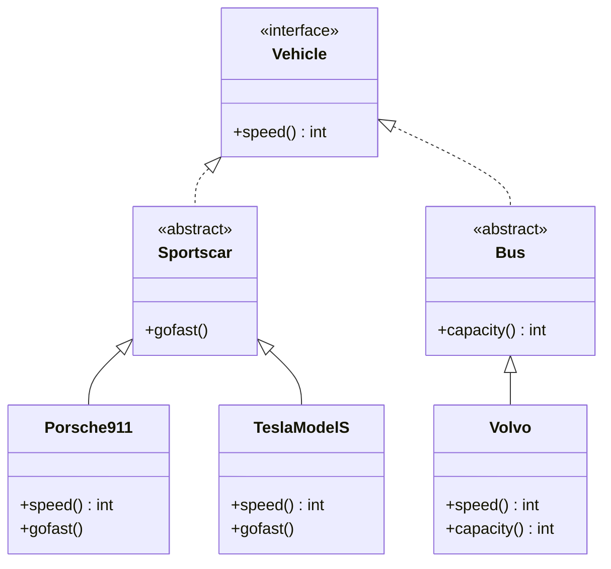
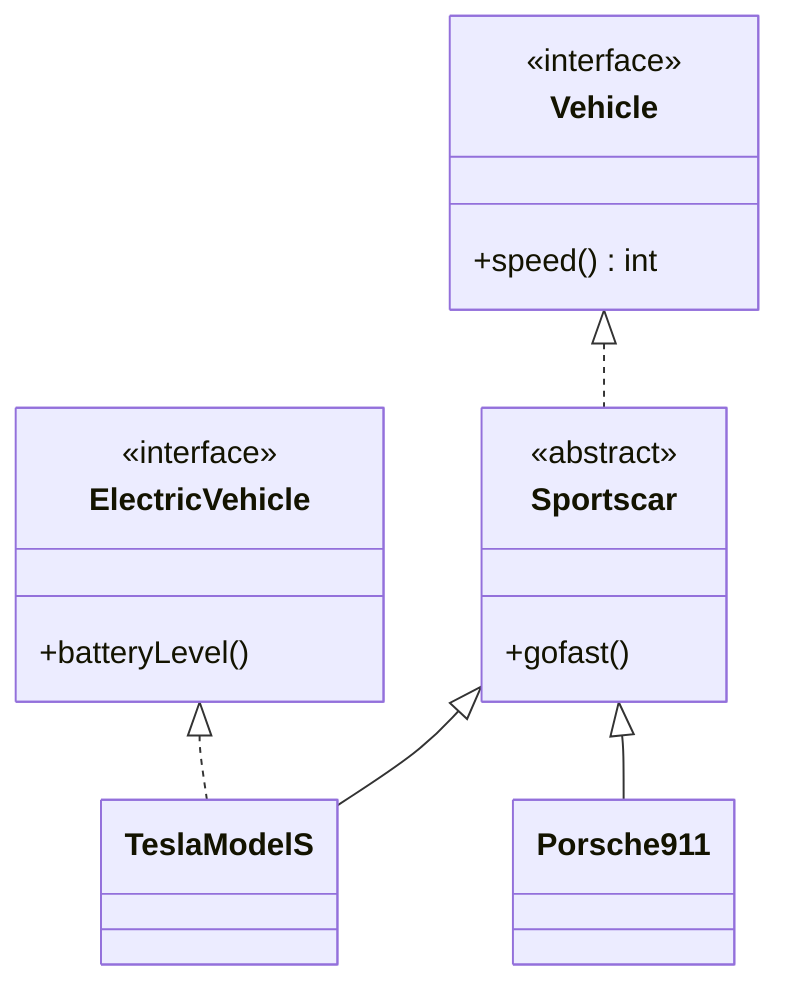
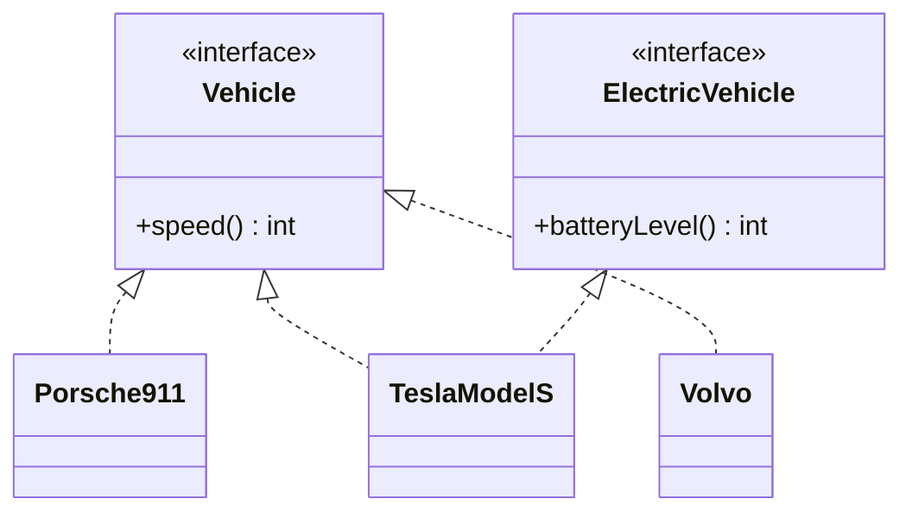

[[Session 4 - Object-Oriented Design.pdf]]

## 1. Recap: Three Kinds of Types

All three are types that represent an **entity or concept**.

|| Fields | Methods | Method implementation |
| --- | :-:|:-:|--- |
|**Class**|✅|✅|Always implemented|
|**Interface**|❌|✅|None, only signatures|
|**Abstract class**|✅|✅|May or may not be implemented|

> [!info] Abstract class = in-between It's a concept between an interface and a class. See [[OOP Lecture 3 - Interfaces and Inheritance#6. Abstract Classes|Abstract Classes]].

---

## 2. Example of OO Design



> [!tip] Reading UML arrows
> 
> - **Dashed line, hollow arrow** (`..|>`) = _implements_ an interface
> - **Solid line, hollow arrow** (`--|>`) = _extends_ a class
> - `<<interface>>` / `<<abstract class>>` = stereotype labels

> [!note] UML notation quirk The slides prefix methods with `-`, which in UML means **private**. Interface methods are always public in Java, so `+` is the correct symbol. The diagram above uses `+`.

### What the diagram means in code

```java
interface Vehicle {
    int speed(); // every vehicle must report its speed
}

abstract class Sportscar implements Vehicle {
    abstract void gofast(); // every sportscar can go fast...
    // ...and speed() is still unimplemented, so subclasses must provide it
}

abstract class Bus implements Vehicle {
    abstract int capacity(); // every bus has a passenger capacity
}

class Porsche911 extends Sportscar {
    public int speed() { return 293; } // from Vehicle
    void gofast() { /* ... */ }        // from Sportscar
}

class Volvo extends Bus {
    public int speed() { return 100; } // from Vehicle
    int capacity() { return 80; }      // from Bus
}
```

> [!important] Why the leaf classes list `speed()` `Sportscar` and `Bus` are abstract, so they don't have to implement `speed()`. The obligation is passed down: the first **concrete** class (Porsche, Tesla, Volvo) must implement everything left over.

---

## 3. Multiple Inheritance

What if a Tesla is both a **sportscar** and an **electric vehicle**?



```java
interface ElectricVehicle {
    int batteryLevel();
}

// extends ONE class, implements any number of interfaces
class TeslaModelS extends Sportscar implements ElectricVehicle {
    public int speed() { return 250; }      // from Vehicle
    void gofast() { /* ... */ }             // from Sportscar
    public int batteryLevel() { return 87; } // from ElectricVehicle
}
```

Now a Tesla is a `TeslaModelS`, a `Sportscar`, a `Vehicle` **and** an `ElectricVehicle`. It can be passed to any method expecting any of those types.

> [!warning] Java's rule
> 
> - A class can **extend only one** class.
> - A class can **implement many** interfaces.
> - An interface can **extend many** interfaces.
> 
> So in Java, "multiple inheritance" happens through interfaces only. (Two superclasses could both define the same method with different code, and Java avoids that ambiguity.)

> [!note] Slide detail The slide's Tesla box doesn't list `batteryLevel()`, but since it implements `ElectricVehicle`, it must implement it.

---

## 4. What We Can Do (and the limits)

We have **a lot of flexibility** when creating class hierarchies, but:

1. ❌ **No cycles** in the inheritance hierarchy (`A extends B`, `B extends A`).
2. ❌ An **interface cannot extend a class**.
3. ❌ You **cannot extend** an interface or class marked `final`.
4. ❌ You **cannot override** a method marked `final`.

```java
final class Money { ... }
class FakeMoney extends Money { } // ❌ compile error: Money is final

class Account {
    final void audit() { ... }    // locked behavior
}
class SneakyAccount extends Account {
    @Override
    void audit() { }              // ❌ compile error: audit() is final
}
```

> [!tip] When to use `final` When subclasses must **not** change the behavior, e.g. a security check or something that guarantees an invariant. `String` in Java is a `final` class for this reason.

---

## 5. What We Should Not Do

We _can_ build complex hierarchies of interfaces, abstract classes and classes.

> [!quote] Key message **Just because we can, doesn't mean we should.**

### Advice

|✅ Do|❌ Avoid|
|---|---|
|Use **interfaces**|**Deep** inheritance|
|Use **classes that implement interfaces**|**Abstract classes**|

> [!question] Why? (my explanation, not on the slides)
> 
> - **Deep hierarchies are fragile**: a change in a class high up ripples down to every subclass, often in surprising ways.
> - **They're hard to read**: to understand one class you have to read all its ancestors.
> - **Inheritance is rigid**: you only get _one_ superclass, so picking the wrong one early locks you in. Interfaces don't have that limit (see the Tesla example).
> - **Interfaces keep code decoupled**: code that depends on `Vehicle` works with any vehicle, without caring how it's built.
> - To share code without inheriting, a class can instead **hold an object** that does the work (_composition_, "has-a" instead of "is-a").

### The recommended shape



Flat: interfaces on top, concrete classes directly below.

---

## Key Terms

- **Class hierarchy** – the tree of types connected by `extends`/`implements`
- **Concrete class** – a non-abstract class that can be instantiated
- **Multiple inheritance** – one type having several supertypes; in Java, only via interfaces
- **`final` class / interface** – cannot be extended
- **`final` method** – cannot be overridden
- **UML class diagram** – visual notation for classes and their relationships
- **Composition** – reusing code by holding another object ("has-a") rather than inheriting ("is-a")