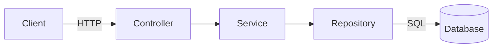
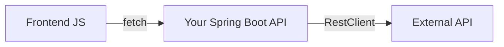

https://spring.io/projects/spring-boot

# OOP Lecture 5 – Spring Boot

> [!summary] TL;DR
> 
> - **Spring** is a big Java framework for building applications. **Spring Boot** is a layer on top that sets most of it up for you so you can "just run" an app.
> - Create a project with **Spring Initializr** (website or IntelliJ), pick your dependencies, and run the generated `main` method.
> - **Routes**: a `@RestController` class with methods annotated `@GetMapping`, `@PostMapping`, …
> - **Database**: an `@Entity` class + a `JpaRepository` interface, and Spring writes the SQL for you.
> - **API calls**: the frontend calls your routes with `fetch`; your backend calls other APIs with `RestClient`.

Previous: [[Software Engineer/3 Semester/OOP/Notes/Lecture 4|Lecture 4]]

---

## 1. What is Spring / Spring Boot?

**Spring Framework**: a large toolkit for Java apps (web, databases, security, …). Powerful but historically a lot of configuration.

**Spring Boot**: an _opinionated_ layer on top of Spring. Key features:

- Creates **stand-alone** apps you start with a normal `main` method.
- **Embeds a web server** (Tomcat by default), so no separate server install or WAR deployment.
- **Starter dependencies**: pick "Spring Web" and you get everything needed for a web app in one go.
- **Auto-configuration**: Spring looks at what's on your classpath and configures it for you (add a database driver → it sets up a database connection).
- Production extras: health checks, metrics, external config.
- No code generation and no XML configuration.

> [!info] Version Current stable version at the time of writing: **Spring Boot 4.1.1**. Spring Boot 4 requires **Java 17 or newer**.

### Core idea: Inversion of Control (IoC)

Normally _you_ create objects with `new`. In Spring, the framework creates and manages important objects for you (called **beans**) and hands them to the classes that need them. That hand-off is called **dependency injection**.

```java
@Service // "Spring, please create and manage one of these"
public class PlayerService { ... }

@RestController
public class PlayerController {
    private final PlayerService service;

    // Spring sees this constructor and passes in its PlayerService automatically
    public PlayerController(PlayerService service) {
        this.service = service;
    }
}
```

> [!tip] Connection to earlier lectures Dependency injection works best when classes depend on **interfaces**, matching the advice in [[OOP Lecture 4 - Object Oriented Design#5. What We Should Not Do|Lecture 4]].

---

## 2. Setting Up a Project

### Option A: Spring Initializr (website)

1. Go to **[start.spring.io](https://start.spring.io/)**.
2. Choose:
    - **Project**: Maven (or Gradle)
    - **Language**: Java
    - **Spring Boot**: the latest stable version (no `SNAPSHOT`/`M`/`RC`)
    - **Group**: reversed domain, e.g. `dk.aau.cs` (see [[OOP Lecture 2 - Classes, Packages, Encapsulation#Naming convention|package naming]])
    - **Artifact**: project name, e.g. `demo`
    - **Packaging**: Jar
    - **Java**: 17 or newer (match the JDK you have installed)
3. **Add dependencies**:
    - **Spring Web**: routes / REST API
    - **Spring Data JPA**: database access
    - **H2 Database**: simple in-memory database for development
    - _(optional)_ **Spring Boot DevTools**: auto-restart on code changes
4. Click **Generate**, unzip, and open the folder in IntelliJ (`File → Open`, pick the folder with `pom.xml`).

### Option B: IntelliJ IDEA

1. `File → New → Project` → **Spring Boot** (called _Spring Initializr_ in older versions).
2. Fill in the same fields as above → **Next** → select the same dependencies → **Create**.

> [!note] IntelliJ editions The built-in Spring wizard is an **Ultimate** feature (free for students with a JetBrains student license). Without it, just use Option A and open the project.

### Running it

Open the generated main class and press ▶ (or run `./mvnw spring-boot:run` in a terminal).

```java
package dk.aau.cs.demo;

import org.springframework.boot.SpringApplication;
import org.springframework.boot.autoconfigure.SpringBootApplication;

@SpringBootApplication // turns on auto-configuration + component scanning
public class DemoApplication {
    public static void main(String[] args) {
        SpringApplication.run(DemoApplication.class, args); // starts the embedded server
    }
}
```

The app now runs on **http://localhost:8080**.

> [!warning] Component scanning Spring only finds your `@RestController`, `@Service`, etc. if they are in the **same package as the main class or a sub-package**. Put your classes in `dk.aau.cs.demo` or `dk.aau.cs.demo.something`.

### Project structure

```
demo/
├── pom.xml                         ← dependencies (Maven)
└── src/
    ├── main/
    │   ├── java/dk/aau/cs/demo/
    │   │   ├── DemoApplication.java   ← main class
    │   │   ├── controller/            ← routes
    │   │   ├── service/               ← business logic
    │   │   ├── repository/            ← database access
    │   │   └── model/                 ← entities
    │   └── resources/
    │       ├── application.properties ← configuration
    │       └── static/                ← HTML/CSS/JS served as-is
    └── test/
```

> [!tip] Serving a frontend Files in `src/main/resources/static/` are served automatically: `static/index.html` → `http://localhost:8080/`.

---

## 3. Setting Up Routes

A **route** (endpoint) = an HTTP method + a URL path, mapped to a Java method.

```java
package dk.aau.cs.demo.controller;

import org.springframework.web.bind.annotation.*;

@RestController            // return values are sent back as JSON (or plain text)
@RequestMapping("/api")    // prefix for every route in this class
public class HelloController {

    // GET http://localhost:8080/api/hello
    @GetMapping("/hello")
    public String hello() {
        return "Hello from Spring Boot!";
    }

    // GET /api/greet?name=Ahmad   → query parameter
    @GetMapping("/greet")
    public String greet(@RequestParam(defaultValue = "world") String name) {
        return "Hello, " + name + "!";
    }

    // GET /api/square/7   → path variable (part of the URL itself)
    @GetMapping("/square/{n}")
    public int square(@PathVariable int n) {
        return n * n;
    }
}
```

### HTTP methods

|Annotation|HTTP method|Typical use|
|---|---|---|
|`@GetMapping`|GET|Read data|
|`@PostMapping`|POST|Create something|
|`@PutMapping`|PUT|Replace/update something|
|`@DeleteMapping`|DELETE|Delete something|

### Getting data from the request

|Annotation|Where the data comes from|Example|
|---|---|---|
|`@PathVariable`|The URL path|`/players/5`|
|`@RequestParam`|Query string|`/players?name=Ana`|
|`@RequestBody`|JSON body (POST/PUT)|`{ "name": "Ana" }`|

> [!info] Automatic JSON Return a Java object (or a `List` of them) and Spring converts it to JSON. Accept a `@RequestBody` object and Spring converts incoming JSON into it. Field names must match the JSON keys.

---

## 4. Setting Up a Database

We use **Spring Data JPA**: you describe your data as Java classes, and Spring handles the SQL.



> [!important] Layered architecture
> 
> - **Controller**: handles HTTP (routes). No business logic.
> - **Service**: business logic and rules.
> - **Repository**: talks to the database.
> 
> Each class has one responsibility, as in [[OOP Lecture 2 - Classes, Packages, Encapsulation#5. What Goes in a Class?|Lecture 2]].

### Step 1: Configure the connection (`application.properties`)

```properties
# H2 in-memory database (data is lost on restart: fine for development)
spring.datasource.url=jdbc:h2:mem:demodb
spring.datasource.username=sa
spring.datasource.password=

# Create/update tables automatically from your @Entity classes
spring.jpa.hibernate.ddl-auto=update

# Print the SQL Spring runs (useful for learning)
spring.jpa.show-sql=true

# Browser UI for the database at /h2-console
spring.h2.console.enabled=true
```

> [!tip] Keep data between restarts Use a file instead of memory: `spring.datasource.url=jdbc:h2:file:./data/demodb`. For a "real" database (PostgreSQL/MySQL), add its driver dependency and change the URL, username and password. The Java code stays the same.

### Step 2: Entity (a class = a table)

```java
package dk.aau.cs.demo.model;

import jakarta.persistence.*;

@Entity // this class maps to a database table "player"
public class Player {

    @Id                                                  // primary key
    @GeneratedValue(strategy = GenerationType.IDENTITY)  // DB auto-increments it
    private Long id;

    private String name;  // becomes a column
    private int rating;   // becomes a column

    protected Player() {} // JPA requires an empty constructor

    public Player(String name, int rating) {
        this.name = name;
        this.rating = rating;
    }

    // getters and setters (encapsulation!)
    public Long getId() { return id; }
    public String getName() { return name; }
    public int getRating() { return rating; }
    public void setName(String name) { this.name = name; }
    public void setRating(int rating) { this.rating = rating; }
}
```

### Step 3: Repository (just an interface!)

```java
package dk.aau.cs.demo.repository;

import dk.aau.cs.demo.model.Player;
import org.springframework.data.jpa.repository.JpaRepository;
import java.util.List;

// JpaRepository<EntityType, IdType>
public interface PlayerRepository extends JpaRepository<Player, Long> {
    // Spring writes the SQL from the method NAME:
    List<Player> findByName(String name);              // WHERE name = ?
    List<Player> findByRatingGreaterThan(int rating);  // WHERE rating > ?
}
```

> [!important] You never implement this interface Spring generates the implementation at run-time. You get `save`, `findById`, `findAll`, `deleteById`, `count`, … for free. A neat use of interfaces from [[OOP Lecture 3 - Interfaces and Inheritance|Lecture 3]].

### Step 4: Service

```java
package dk.aau.cs.demo.service;

import dk.aau.cs.demo.model.Player;
import dk.aau.cs.demo.repository.PlayerRepository;
import org.springframework.stereotype.Service;
import java.util.List;

@Service
public class PlayerService {
    private final PlayerRepository repo;

    public PlayerService(PlayerRepository repo) { // injected by Spring
        this.repo = repo;
    }

    public List<Player> getAll() {
        return repo.findAll();
    }

    public Player getById(Long id) {
        return repo.findById(id)
                   .orElseThrow(() -> new IllegalArgumentException("No player " + id));
    }

    public Player create(Player player) {
        if (player.getRating() < 0) {                 // business rule lives here
            throw new IllegalArgumentException("Rating can't be negative");
        }
        return repo.save(player);                     // INSERT, returns it with an id
    }

    public void delete(Long id) {
        repo.deleteById(id);
    }
}
```

### Step 5: Controller (the routes)

```java
package dk.aau.cs.demo.controller;

import dk.aau.cs.demo.model.Player;
import dk.aau.cs.demo.service.PlayerService;
import org.springframework.web.bind.annotation.*;
import java.util.List;

@RestController
@RequestMapping("/api/players")
public class PlayerController {
    private final PlayerService service;

    public PlayerController(PlayerService service) {
        this.service = service;
    }

    @GetMapping                       // GET    /api/players
    public List<Player> all() {
        return service.getAll();
    }

    @GetMapping("/{id}")              // GET    /api/players/1
    public Player one(@PathVariable Long id) {
        return service.getById(id);
    }

    @PostMapping                      // POST   /api/players   (JSON body)
    public Player create(@RequestBody Player player) {
        return service.create(player);
    }

    @DeleteMapping("/{id}")           // DELETE /api/players/1
    public void delete(@PathVariable Long id) {
        service.delete(id);
    }
}
```

> [!tip] Viewing the data Open `http://localhost:8080/h2-console`, set the JDBC URL to the one in `application.properties` (`jdbc:h2:mem:demodb`), and click **Connect**.

---

## 5. Making API Calls

"API call" goes in two directions:



### 5a. Calling _your_ API from the frontend (JavaScript)

```javascript
// GET: read all players
async function loadPlayers() {
    const response = await fetch("/api/players");   // same server, so a relative URL works
    const players = await response.json();          // parse the JSON body
    console.log(players);
}

// POST: create a player
async function addPlayer(name, rating) {
    const response = await fetch("/api/players", {
        method: "POST",
        headers: { "Content-Type": "application/json" }, // tell Spring it's JSON
        body: JSON.stringify({ name, rating })            // becomes @RequestBody
    });
    const created = await response.json();
    console.log("Created with id", created.id);
}
```

> [!warning] CORS If the frontend runs on a **different origin** (e.g. Live Server on port 5500 and Spring on 8080), the browser blocks the call. Either serve the frontend from `src/main/resources/static/`, or allow it in Spring:
> 
> ```java
> @CrossOrigin(origins = "http://localhost:5500") // put on the controller class
> ```

### 5b. Testing your API without a frontend

- Open GET routes directly in the browser: `http://localhost:8080/api/players`
- IntelliJ **HTTP Client**: create a `requests.http` file:

```http
### Get all players
GET http://localhost:8080/api/players

### Create a player
POST http://localhost:8080/api/players
Content-Type: application/json

{ "name": "Ana", "rating": 1500 }
```

- Or **curl** in a terminal:

```bash
curl -X POST http://localhost:8080/api/players \
     -H "Content-Type: application/json" \
     -d '{"name":"Ana","rating":1500}'
```

- Or tools like **Postman** / **Insomnia**.

### 5c. Calling an _external_ API from Spring (backend)

Use **`RestClient`** (the modern replacement for the older `RestTemplate`).

```java
package dk.aau.cs.demo.service;

import org.springframework.stereotype.Service;
import org.springframework.web.client.RestClient;

@Service
public class JokeService {

    private final RestClient client = RestClient.create("https://official-joke-api.appspot.com");

    // A record is a compact class for holding data; field names match the JSON keys
    public record Joke(String setup, String punchline) {}

    public Joke randomJoke() {
        return client.get()                 // HTTP GET
                     .uri("/random_joke")   // appended to the base URL
                     .retrieve()            // send the request
                     .body(Joke.class);     // convert the JSON response into a Joke
    }
}
```

```java
@RestController
public class JokeController {
    private final JokeService jokes;

    public JokeController(JokeService jokes) { this.jokes = jokes; }

    @GetMapping("/api/joke") // your API forwards data from the external API
    public JokeService.Joke joke() {
        return jokes.randomJoke();
    }
}
```

> [!tip] Why call external APIs from the backend? It keeps **API keys secret** (never put them in frontend JS), lets you **cache** or **reshape** the data, and avoids CORS problems with the external site.

---

## Common Annotations Cheat Sheet

|Annotation|Meaning|
|---|---|
|`@SpringBootApplication`|Main class: enables auto-config + component scanning|
|`@RestController`|Class with routes that return data (JSON)|
|`@RequestMapping("/x")`|URL prefix for all routes in the class|
|`@GetMapping` / `@PostMapping` / `@PutMapping` / `@DeleteMapping`|Route for that HTTP method|
|`@PathVariable`|Value from the URL path|
|`@RequestParam`|Value from the query string|
|`@RequestBody`|JSON body → Java object|
|`@Service`|Business-logic bean|
|`@Repository`|Database-access bean (optional on `JpaRepository` interfaces)|
|`@Entity`|Class mapped to a database table|
|`@Id` / `@GeneratedValue`|Primary key / auto-generated|
|`@CrossOrigin`|Allow calls from another origin (CORS)|

---

## Key Terms

- **Spring Framework** – large Java framework for building applications
- **Spring Boot** – opinionated layer on Spring that auto-configures and runs apps easily
- **Spring Initializr** – tool (website/IntelliJ) that generates a Spring Boot project
- **Starter** – a dependency that bundles everything for a feature (e.g. Spring Web)
- **Auto-configuration** – Spring configures libraries it finds on the classpath
- **Bean** – an object created and managed by Spring
- **Inversion of Control / Dependency Injection** – Spring creates objects and passes them to the classes that need them
- **Endpoint / route** – HTTP method + URL mapped to a Java method
- **REST API** – web API using HTTP methods and URLs to work with resources, usually as JSON
- **JPA** – Java standard for mapping objects to database tables
- **Entity** – a class mapped to a table
- **Repository** – interface for database access; Spring implements it
- **CORS** – browser rule blocking requests between different origins unless allowed
- **RestClient** – Spring's client for calling other HTTP APIs

## Further Reading

- [Spring Boot project page](https://spring.io/projects/spring-boot)
- [Spring Initializr](https://start.spring.io/)
- [Quickstart Guide](https://spring.io/quickstart)
- [Building a RESTful Web Service](https://spring.io/guides/gs/rest-service/)
- [All Spring Guides](https://spring.io/guides)