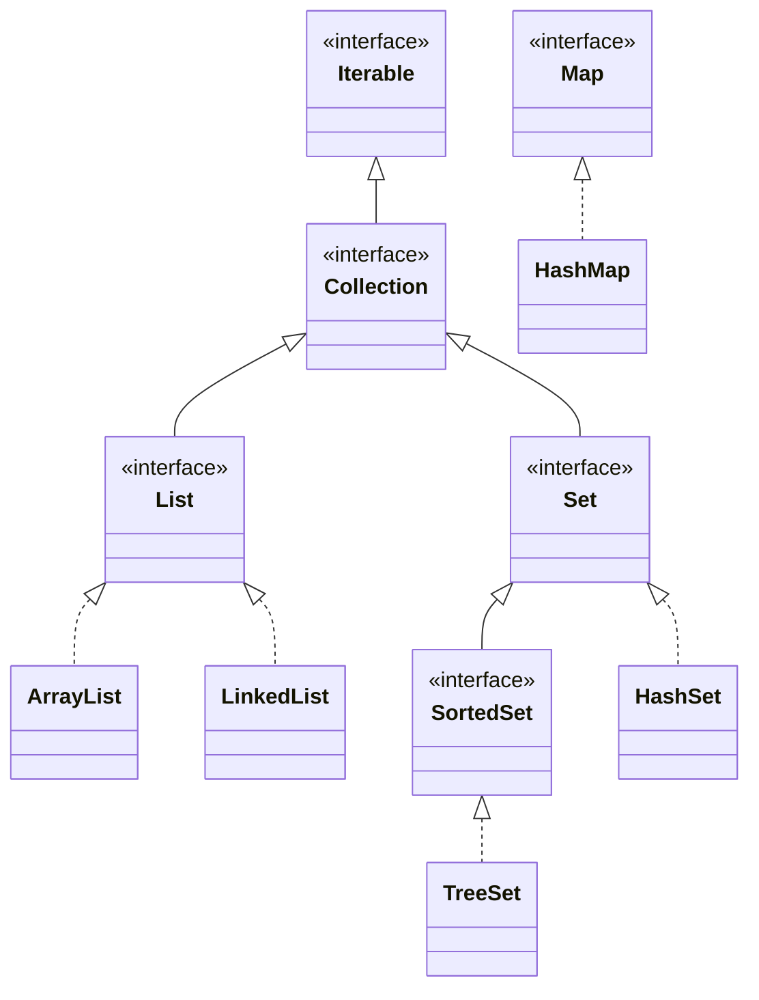
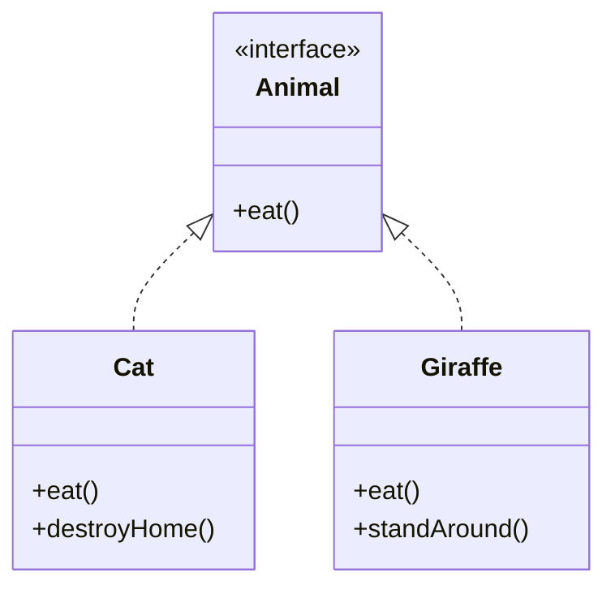

[[Session 6 - Object Class.pdf]]
[[Session 6 - Generics.pdf]]
[[Session 6 - Collections.pdf]]

# Collections, the Object Class & Generics

> [!summary] TL;DR
> 
> - The **Collections Library** gives ready-made interfaces (`List`, `Set`, `Map`), implementations (`ArrayList`, `HashSet`, `HashMap`) and algorithms (`sort`, `shuffle`, …). Use them instead of arrays.
> - **Every class extends `Object`**, so every object has `equals`, `hashCode` and `toString`.
> - `==` checks **reference equality** (same object); `equals` checks **object equality** (whatever you define). Override `equals` → **also override `hashCode`**.
> - **Generics** (`Stack<T>`) let you write one class that works for any type, safely. This is _parametric polymorphism_.

Previous: [[Software Engineer/3 Semester/OOP/Notes/Lecture 5|Lecture 5]]

---

# Part 1 – Collections

## 1. What is a Collection?

A **collection** is a group of objects organized in some way.

- A poker hand → a collection of cards
- A mailbox → a collection of letters
- A telephone directory → a **mapping** from names to numbers

The **Java Collections Library** is a set of reusable components:

|Part|Examples|
|---|---|
|**Interfaces**|`Collection<T>`, `List<T>`, `Set<T>`, `Map<K, V>`|
|**Implementations**|`ArrayList<T>`, `LinkedList<T>`, `HashSet<T>`, `HashMap<K, V>`|
|**Algorithms**|min/max, sorting, shuffling, …|

## 2. Why Collections Instead of Arrays?

|Arrays|Collections|
|---|---|
|Low-level: a chunk of memory|High-level abstraction|
|Few operations, cumbersome|Rich operations, easy to use|
|Fixed size|Grow and shrink automatically|

- Saves time: no re-inventing the wheel.
- Everyone uses them, which makes code easier to reuse and read.
- Heavily optimized, probably better than what we'd write ourselves.

> [!important] Rule from now on **Arrays be gone! Use collections** (unless you have a good reason not to).

```java
// Array: fixed size, have to track positions yourself
String[] arr = new String[3];
arr[0] = "a";

// Collection: grows as needed, lots of helpful methods
List<String> list = new ArrayList<>();
list.add("a");
list.add("b");
list.contains("b"); // true
```

## 3. The Collections Hierarchy



> [!note] `Map` is not a `Collection` `Map` stands on its own: it stores **pairs** (key → value), not single elements. You can still get collections _from_ it with `keySet()` and `values()`.

> [!tip] Program to the interface
> 
> ```java
> List<String> cards = new ArrayList<>(); // ✅ variable type is the interface
> ArrayList<String> cards = new ArrayList<>(); // works, but ties you to one implementation
> ```
> 
> Switching to `LinkedList` later is then a one-word change. Same idea as [[OOP Lecture 4 - Object Oriented Design#5. What We Should Not Do|"use interfaces"]].

## 4. Overview of the Main Interfaces

|Interface|Description|Relies on|
|---|---|---|
|`Collection<E>`|Common methods for all collections|—|
|`List<E>`|**Ordered** sequence; _you_ control the order; access by position|—|
|`Set<E>`|**Unordered**, **no duplicates**|`equals` (+ `hashCode` for `HashSet`)|
|`SortedSet<E>`|**Sorted**, no duplicates|Natural ordering or a `Comparator`|
|`Map<K, V>`|Maps keys of type `K` to values of type `V`|`equals` on keys (+ `hashCode` for `HashMap`)|

Others worth knowing: `Stack<E>`, `Queue<E>`, `Deque<E>`, …

## 5. `Collection<E>` Methods

|Return|Method|What it does|
|---|---|---|
|`boolean`|`add(E e)`|Add an element|
|`void`|`clear()`|Remove everything|
|`boolean`|`contains(Object o)`|Is `o` in here?|
|`boolean`|`isEmpty()`|No elements?|
|`Iterator<E>`|`iterator()`|Iterator over the elements|
|`boolean`|`remove(Object o)`|Remove one occurrence of `o`|
|`int`|`size()`|Number of elements|
|`Stream<E>`|`stream()`|A stream with this collection as source|

> [!info] "Optional operation" Some methods may throw `UnsupportedOperationException`, e.g. calling `add` on an unmodifiable list from `List.of(...)`.

## 6. `List<E>`

Extra methods that work with **positions** (indexes start at 0):

|Return|Method|What it does|
|---|---|---|
|`void`|`add(int index, E element)`|Insert at a position|
|`E`|`get(int index)`|Element at a position|
|`int`|`indexOf(Object o)`|First position of `o`, or `-1`|
|`int`|`lastIndexOf(Object o)`|Last position of `o`, or `-1`|
|`E`|`remove(int index)`|Remove the element at a position|
|`List<E>`|`subList(int from, int to)`|View of `from` (inclusive) to `to` (exclusive)|

### `ArrayList` vs `LinkedList`

||`ArrayList<E>`|`LinkedList<E>`|
|---|---|---|
|Backed by|An array|Linked cells (each points to the next)|
|`get(index)`|⚡ Fast: jump straight there|🐢 Slow: walk through the list|
|Insert at front|🐢 Slow: shifts every element|⚡ Fast: just relink|

```
ArrayList:   [a][b][c][d][e]         ← one block of memory
LinkedList:  [a] → [b] → [c]         ← cells pointing to each other
```

> [!note] Slide nuance The slide says ArrayList "cannot insert elements in the front". It _can_ (`list.add(0, x)`), it's just **slow** because every other element has to move one step.

> [!tip] Default choice **Use `ArrayList`.** It's the most common and usually fastest in practice.

### Example

```java
List<String> cards = new ArrayList<>();
cards.add("Ace of Hearts");   // index 0
cards.add("Queen of Spades"); // index 1
cards.add("Ten of Hearts");   // index 2
cards.add("Ace of Hearts");   // index 3 (duplicates allowed in a List)
cards.add("Two of Clubs");    // index 4

cards.remove(1);              // removes "Queen of Spades"; everything after shifts left
// now: [Ace of Hearts, Ten of Hearts, Ace of Hearts, Two of Clubs]

int index = cards.indexOf("Ten of Hearts");
System.out.println(index);    // prints 1
```

> [!warning] `remove(1)` vs `remove("x")` `remove(int)` removes by **position**; `remove(Object)` removes by **value**. With a `List<Integer>`, `list.remove(1)` removes index 1, not the number 1!

## 7. The `Collections` Utility Class (algorithms)

Note the **s**: `Collections` (class with static helpers) ≠ `Collection` (interface).

|Method|What it does|
|---|---|
|`Collections.sort(list)`|Sort ascending by natural ordering|
|`Collections.sort(list, comparator)`|Sort using a `Comparator`|
|`Collections.shuffle(list)`|Random order|
|`Collections.binarySearch(list, key)`|Fast search in a **sorted** list|
|`Collections.binarySearch(list, key, comparator)`|Same, with a comparator|
|`Collections.min(c)` / `Collections.max(c)`|Smallest / largest|

## 8. `Comparator<T>`

An interface that defines **how to order two objects**.

```java
public interface Comparator<T> {
    // negative → o1 comes first
    // zero     → equal
    // positive → o2 comes first
    int compare(T o1, T o2);
}
```

```java
List<Person> people = new ArrayList<>(/* ... */);

// 1) As a class implementing the interface
class ByAge implements Comparator<Person> {
    public int compare(Person a, Person b) {
        return Integer.compare(a.getAge(), b.getAge()); // safe way to compare ints
    }
}
Collections.sort(people, new ByAge());

// 2) As a lambda (same thing, shorter)
Collections.sort(people, (a, b) -> Integer.compare(a.getAge(), b.getAge()));

// 3) Using the built-in helper (shortest)
people.sort(Comparator.comparing(Person::getName));
```

> [!tip] Don't write `a.getAge() - b.getAge()` It works for small numbers but can overflow with large ones. `Integer.compare` is always correct.

## 9. `Set<E>`

No duplicates, no guaranteed order.

```java
Set<String> cards = new HashSet<>();
cards.add("Ace of Hearts");
cards.add("Ace of Hearts");   // ignored: already there (add returns false)
cards.add("Queen of Spades");
cards.add("Queen of Spades"); // ignored
cards.add("Ten of Hearts");
cards.add("Two of Clubs");

cards.remove("Ten of Hearts");

System.out.println(cards.size()); // prints 3: Ace of Hearts, Queen of Spades, Two of Clubs
```

|Implementation|Order|Notes|
|---|---|---|
|`HashSet`|None (looks random)|Fastest; uses `hashCode` + `equals`|
|`TreeSet`|Sorted|Implements `SortedSet`; uses natural order or a `Comparator`|
|`LinkedHashSet`|Insertion order|Bonus: not on the slides|

## 10. `Map<K, V>`

|Return|Method|What it does|
|---|---|---|
|`V`|`put(K key, V value)`|Add/replace a key → value pair|
|`V`|`get(Object key)`|Value for key, or **`null`** if missing|
|`V`|`getOrDefault(Object key, V def)`|Value for key, or `def` if missing|
|`boolean`|`containsKey(Object key)`|Is this key present?|
|`boolean`|`containsValue(Object value)`|Is this value present?|
|`Set<K>`|`keySet()`|All keys (a `Set`: keys are unique)|
|`Collection<V>`|`values()`|All values (may contain duplicates)|

```java
Map<String, Integer> birthYear = new HashMap<>();
birthYear.put("George Washington", 1732);
birthYear.put("Abraham Lincoln", 1809);
birthYear.put("Barack Obama", 1961);

Integer obamaYear = birthYear.get("Barack Obama"); // 1961
System.out.println("Mr. Obama was born in: " + obamaYear);

// Loop over all keys
for (String president : birthYear.keySet()) {
    System.out.println("Mr. " + president); // order NOT guaranteed with HashMap
}
```

> [!tip] Looping over keys **and** values
> 
> ```java
> for (Map.Entry<String, Integer> e : birthYear.entrySet()) {
>     System.out.println(e.getKey() + " → " + e.getValue());
> }
> ```

> [!warning] Why `Integer` and not `int`? Collections can only hold **objects**, so primitives are wrapped: `int` → `Integer`, `double` → `Double`, `boolean` → `Boolean`. Java converts automatically (_autoboxing_), but `get` can return `null`, and `int x = map.get("missing");` crashes with a `NullPointerException`.

---

# Part 2 – The `java.lang.Object` Class

## 11. Every Class Extends `Object`

> [!important] Read that sentence again **Every class extends the Java `Object` class**, even if you never write `extends`. So every object is guaranteed to have these methods:

|Method|Purpose|
|---|---|
|`boolean equals(Object obj)`|Is another object "equal to" this one?|
|`int hashCode()`|A number used by hash-based collections|
|`String toString()`|Text representation of the object|
|`Class<?> getClass()`|The run-time class of the object|
|`protected Object clone()`|Create a copy|
|`protected void finalize()`|Called by GC before deletion (**deprecated**, don't use)|
|`notify()`, `notifyAll()`, `wait(...)`|Thread coordination (not needed for now)|

```java
class Person { ... }                 // what you write
class Person extends Object { ... }  // what Java sees
```

## 12. Equality

We often want to know when two objects are "the same", but **equality is a nebulous concept** (_Ceci n'est pas une pipe_: a picture of a pipe isn't a pipe).

- Two `Person`s with the same first and last name: same person? What if their ages differ?
- Two `File`s: same if same filename? Same content? At what point in time?
- Two dates: same date in what calendar? Leap seconds? Time zones?

> [!question] Takeaway There's no single right answer. **You** decide what "equal" means for your class.

## 13. Two Types of Equality in Java

### Reference equality: `==`

- Same if they refer to the **same memory location** (the same object).
- `new Object() != new Object()`: two separate objects are never `==`.

### Object equality: `equals`

- Same if the `equals` method **says so**.
- Default implementation (from `Object`) = reference equality.
- You're meant to **override** `equals` with your own logic.
- If you override `equals`, you **must also override `hashCode`**, otherwise disaster follows.

```java
String a = new String("hi");
String b = new String("hi");

a == b;        // false: two different objects
a.equals(b);   // true:  String overrides equals to compare characters
```

> [!warning] Exam trap **Always compare strings (and objects) with `.equals`, never `==`.** Ties back to [[OOP Lecture 2 - Classes, Packages, Encapsulation#3. References and Aliasing|references and aliasing]].

### Overriding `equals` and `hashCode`

```java
import java.util.Objects;

public class Person {
    private String firstName;
    private String lastName;
    private int age; // we decide: age does NOT affect equality

    @Override
    public boolean equals(Object o) {
        if (this == o) return true;                          // same object → equal
        if (o == null || getClass() != o.getClass()) return false; // null or different class
        Person other = (Person) o;                           // safe cast now
        return Objects.equals(firstName, other.firstName)
            && Objects.equals(lastName, other.lastName);
    }

    @Override
    public int hashCode() {
        return Objects.hash(firstName, lastName); // use the SAME fields as equals
    }
}
```

> [!important] The contract If `a.equals(b)` is `true`, then `a.hashCode() == b.hashCode()` **must** be true. Use the **same fields** in both methods.

> [!bug] The "disaster" (my explanation) `HashSet` and `HashMap` first use `hashCode` to find the right "bucket", then `equals` inside it. If two equal objects have different hash codes, they land in different buckets:
> 
> ```java
> Set<Person> set = new HashSet<>();
> set.add(new Person("Ada", "Lovelace", 36));
> set.contains(new Person("Ada", "Lovelace", 36)); // false without hashCode! 😱
> ```
> 
> Duplicates sneak into sets and map lookups silently fail. (The slides say sets "rely on `equals`", but `HashSet` relies on **both**.)

> [!tip] Let IntelliJ do it `Alt+Insert` (Windows/Linux) / `Cmd+N` (Mac) → **equals() and hashCode()** generates both correctly.

## 14. `toString`

Returns a **string representation** of the object. Called automatically by `println` and string concatenation.

```java
Person person = new Person("Magnus", 31);
System.out.println(person);
// Default output: Person@4554617c   ← class name + hash code in hex, not useful
```

```java
@Override
public String toString() {
    return "Person{" + "name='" + name + '\'' + ", age=" + age + '}';
}
// Output: Person{name='Magnus', age=31}
```

> [!tip] Always override `toString` Makes debugging and printing far easier. IntelliJ can generate it too (`Alt+Insert` → **toString()**).

---

# Part 3 – Generics

## 15. Polymorphism Recap

**Poly morph = many shapes.** A variable of type `Animal` can hold a `Cat` or a `Giraffe`, and `animal.eat()` behaves differently depending on the **run-time type**.

Modern OO languages have **two kinds** of polymorphism, and we need both:

|Kind|Mechanism|Idea|
|---|---|---|
|**Subtype** polymorphism|Inheritance / interfaces|One API, different _behaviors_|
|**Parametric** polymorphism|**Generics**|One implementation, different _types_|

### Subtype polymorphism (seen before)

Extract what entities have in common into one API.



Both eat, but differently: a cat hunts, a giraffe forages. See [[OOP Lecture 3 - Interfaces and Inheritance#3. Subtyping & Polymorphism|Lecture 3]].

## 16. The Problem: A Stack of …

```java
public class BookStack {
    private Book[] stack = ...;
    Book pop() { ... }
    void push(Book b) { ... }
}

public class GiraffeStack {
    private Giraffe[] stack = ...;
    Giraffe pop() { ... }
    void push(Giraffe g) { ... }
}
```

…and `CatStack`, `PlateStack`, `CoinStack`, `PancakeStack`, … The code is **identical** except for the type. Massive duplication.

> [!question] Why not just use `Object`? A `Stack` of `Object` could hold anything, but then you could accidentally push a `Giraffe` onto your book stack, and every `pop()` needs a cast `(Book) stack.pop()` that can crash at run-time.

## 17. Parametric Polymorphism (Generics)

> [!important] Key idea: introduce a **type parameter** Not `BookStack` and `GiraffeStack`, but one `Stack<T>`, where `T` is a placeholder for a type.
> 
> - Stack of books → `Stack<Book>`
> - Stack of giraffes → `Stack<Giraffe>`
> 
> `Stack<Book>` and `Stack<Giraffe>` are **different types**, and the compiler stops you from mixing them.

### A generic class

```java
public class Stack<T> {             // T = type parameter
    private List<T> items = new ArrayList<>(); // holds Ts

    public void push(T t) {          // accepts only T
        items.add(t);
    }

    public T pop() {                 // returns a T: no cast needed
        return items.remove(items.size() - 1); // take the last one added
    }

    public boolean isEmpty() {
        return items.isEmpty();
    }
}
```

```java
Stack<Book> books = new Stack<>();     // T = Book
books.push(new Book("Dune"));
Book b = books.pop();                  // ✅ no cast

Stack<Giraffe> giraffes = new Stack<>();
giraffes.push(new Book("Dune"));       // ❌ compile error: a Book is not a Giraffe
```

> [!note] Why the example uses a `List` instead of `T[]` The slide uses `private T[] arr = null;`. That's on purpose: Java **doesn't allow `new T[10]`** (generic array creation). Using a collection inside, as above, avoids the problem, which is one more reason for "arrays be gone".

> [!info] You've been using generics all along `List<String>`, `Set<Integer>`, `Map<String, Integer>`: the whole Collections Library is generic. `Map<K, V>` simply has **two** type parameters.

### Conventions

|Letter|Usually means|
|---|---|
|`T`|Type|
|`E`|Element (collections)|
|`K`, `V`|Key, Value (maps)|

> [!warning] No primitives Type arguments must be classes: `Stack<Integer>` ✅, `Stack<int>` ❌.

### The diamond `<>`

```java
Stack<Book> books = new Stack<Book>(); // old style
Stack<Book> books = new Stack<>();     // diamond: Java infers <Book>
```

---

## Key Terms

- **Collection** – a group of objects organized in some way
- **List** – ordered sequence, duplicates allowed, indexed access
- **Set** – no duplicates; `HashSet` unordered, `TreeSet` sorted
- **Map** – key → value pairs with unique keys
- **`Collections`** – utility class with static algorithms (`sort`, `shuffle`, …)
- **Comparator** – object/lambda defining how to order two values
- **Autoboxing** – automatic conversion between `int` and `Integer` etc.
- **`java.lang.Object`** – superclass of every class
- **Reference equality (`==`)** – same object in memory
- **Object equality (`equals`)** – equal according to the class's own definition
- **`hashCode`** – number used by hash collections; must agree with `equals`
- **`toString`** – string representation of an object
- **Subtype polymorphism** – one interface, many behaviors (inheritance)
- **Parametric polymorphism / generics** – one implementation, many types (`Stack<T>`)
- **Type parameter** – placeholder type like `T` in `Stack<T>`
- **Diamond operator `<>`** – lets Java infer type arguments