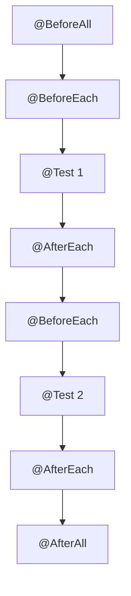
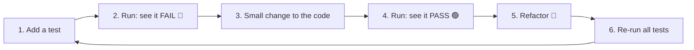

[[Session 7 - Software Testing.pdf]]

---

## course: OOP lecture: 7 lecturer: Magnus Madsen topics: [testing, junit, unit-tests, technical-debt, black-box, white-box, coverage, assertions, contracts, tdd] tags: [oop, java, testing, lecture]

# OOP Lecture 7 – Software Testing

> [!summary] TL;DR
> 
> - A **test** is an experiment: run the program and check the outcome matches what we expect.
> - Tests ensure correctness, help build tricky algorithms, and (most importantly) **let you change and refactor code without breaking it**.
> - Skipping tests, docs and updates builds **technical debt**, which makes a codebase **rot**.
> - **JUnit 5**: annotate methods with `@Test`, check results with `assertEquals`, `assertTrue`, …
> - **TDD**: write a failing test first, make it pass, refactor. Repeat.
> - Testing can show bugs exist, **never** that they don't (Dijkstra).

Previous: [[OOP Lecture 6 - Collections, Object Class, Generics]]

---

## 1. What is a Test?

An **experiment** to determine the outcome of a program execution.

- **Passed** → the outcome matches our expectations.
- **Failed** → the outcome differs from our expectations.

We can test a program when:

- It **compiles and runs**.
- The **expected outcome is understood**.

> [!tip] Test early You can test an **incomplete** program, as long as it compiles and runs.

---

## 2. Why Care About Testing?

1. To **ensure correctness**.
2. To help **implement tricky or hard-to-understand algorithms**.
3. To **enable change and refactoring without causing breakage**.

> [!important] The lecturer's shifted view The slides contrast an "initial view" and a "changed view" of these three reasons. The point: with experience, the **third** reason becomes the most valuable. Tests are a safety net. Change anything, rerun the tests, and you know immediately whether you broke something.

---

## 3. Technical Debt & Software Rot

Every codebase has some **technical debt**: shortcuts that make future work harder, like borrowed money with interest.

You **increase** it every time you:

- Add features **without documentation or tests**.
- Add a **hack** without refactoring it afterwards.
- Rush a feature to be ready **"by Monday"**.
- **Don't update** to a new version of the language, a library or the platform.

As debt grows, the codebase **rots**.

You **decrease** it by:

- Continuously **refactoring** and maintaining the code.
- Continuously **updating** languages, libraries and platforms.
- Adding **unit and system tests**.

> [!warning] Bankruptcy A codebase can accumulate so much debt that it's **cheaper to throw it away and start over** than to fix it. This happens all the time, and it's not good.

---

## 4. Dimensions of Testing

|Question|Option A|Option B|
|---|---|---|
|How are tests run?|**Manual**|**Automated**|
|What does a test cover?|**Unit** test|**System** test|
|What does the test assume about the implementation?|**Black box**|**White box**|
|Written before or after the implementation?|**Test first**|**Test later**|

Every choice is a **trade-off**.

### Manual vs. Automated

||Manual (a human runs it and looks)|Automated (a computer compares to expected result)|
|---|---|---|
|✅|Works well for some things, e.g. UI|Repeatable, little manual effort|
|❌|Tedious, slow, error-prone|Hard to test certain requirements|
|⚖️|—|Costs time now, **pays off later**|

### Unit vs. System

|Unit test|System test|
|---|---|
|Tests **individual components in isolation**|Tests **larger components working together**|
|E.g. one method or a few methods of a class|E.g. many classes cooperating|
|**Easy** to write|**Hard** to write|

> [!important] You need both They serve different purposes. Big companies (think Google) invest big money in good system tests.

### Black Box vs. White Box

|White box (knows the code)|Black box (knows only the spec)|
|---|---|
|✅ Easy to find corner cases|✅ Relies only on the **specification**|
|✅ Easy to know when you've tested enough|✅ No assumptions about the implementation|
|❌ May not match the specification|✅ Paranoid, adversarial approach|
|❌ May not cover a _different_ implementation||
|❌ Tests and code are **coupled**||

> [!info] Red Team vs. Blue Team Black-box testing is like one team (red) trying to break what another team (blue) built, without seeing their code.

---

## 5. JUnit 5

A Java **unit testing framework**:

- Extremely popular and widely used.
- Integrated into IntelliJ IDEA.
- Easy to get started with.
- **Annotation based**.

> [!tip] Creating a test in IntelliJ Put the cursor on a class name → `Alt+Enter` (Mac: `Option+Enter`) → **Create Test** → choose **JUnit 5**. Run tests with the green ▶ next to a test method or class. Spring Boot projects already include JUnit (see [[OOP Lecture 5 - Spring Boot]]).

### Assertion methods

|Method|Passes when…|
|---|---|
|`assertTrue(x)`|`x` is `true`|
|`assertFalse(x)`|`x` is `false`|
|`assertNull(x)`|`x` is `null`|
|`assertNotNull(x)`|`x` is not `null`|
|`assertEquals(expected, actual)`|The two values are equal (uses `equals`)|
|`assertArrayEquals(expected, actual)`|The two arrays have equal contents|
|`fail()`|Never: fails the test unconditionally|
|`assertThrows(Exception.class, () -> ...)`|The code throws that exception _(bonus, not on slides)_|

> [!note] Slide detail The slide's table heading says "Annotation", but these are **static methods** from `org.junit.jupiter.api.Assertions`, not annotations. Import them with:
> 
> ```java
> import static org.junit.jupiter.api.Assertions.*;
> ```

> [!warning] Argument order `assertEquals(expected, actual)`: **expected first**. Swapping them still passes/fails correctly, but the failure message will be backwards and confusing.

### Examples

```java
import org.junit.jupiter.api.Test;
import static org.junit.jupiter.api.Assertions.*;

public class TestBankAccount {

    @Test // marks this method as a unit test
    public void isOverdrawn01() {
        BankAccount account = new BankAccount(100);
        account.withdraw(500_000);           // withdraw way more than the balance
        assertTrue(account.isOverdrawn());   // expect: overdrawn
    }

    @Test
    public void isOverdrawn02() {
        BankAccount account = new BankAccount(100);
        account.withdraw(25);                // small withdrawal
        assertFalse(account.isOverdrawn());  // expect: NOT overdrawn
    }

    @Test
    public void negativeWithdrawThrows() {   // bonus: testing for an exception
        BankAccount account = new BankAccount(100);
        assertThrows(IllegalArgumentException.class, () -> account.withdraw(-10));
    }
}
```

> [!tip] Structure: Arrange → Act → Assert
> 
> 1. **Arrange**: set up objects (`new BankAccount(100)`)
> 2. **Act**: do the thing being tested (`withdraw(25)`)
> 3. **Assert**: check the result (`assertFalse(...)`)

### Annotations

|Annotation|Runs…|
|---|---|
|`@Test`|Marks a method as a unit test|
|`@BeforeAll`|**Once**, before all tests in the class|
|`@BeforeEach`|Before **every** test|
|`@AfterEach`|After **every** test|
|`@AfterAll`|**Once**, after all tests|
|`@Disabled`|Skip this test|



### Example: `@BeforeEach`

```java
@TestInstance(TestInstance.Lifecycle.PER_CLASS)
public class TestBankAccount {
    BankAccount account = null;

    @BeforeEach
    public void beforeEach() {
        account = new BankAccount(100); // a FRESH account before every test
    }

    @Test
    public void withdraw01() {
        account.withdraw(25);
        assertEquals(75, account.getBalance()); // expected 75, actual = balance
    }
}
```

> [!info] What's `@TestInstance(PER_CLASS)`? By default JUnit creates a **new instance of the test class for every test**, and `@BeforeAll`/`@AfterAll` must then be `static`. `PER_CLASS` uses **one instance** for all tests, which allows non-static `@BeforeAll`. For this `@BeforeEach` example it isn't actually needed.

> [!tip] Why `@BeforeEach` matters Each test gets its own fresh account, so tests can't affect each other. That's the **I** in [[#11. F.I.R.S.T. Principles|F.I.R.S.T.]]

---

## 6. Test Coverage

**Q:** How do we know if a test suite is useful? **A:** Measure its **coverage**:

|Metric|Measures|
|---|---|
|**Method** coverage|% of methods executed|
|**Statement** coverage|% of statements executed|
|**Path** coverage|Number of paths through the code taken|

> [!tip] IntelliJ Right-click a test class/folder → **Run with Coverage**. Covered lines turn green, missed ones red.

> [!warning] "…but" High coverage is measurable and achievable, **but** it doesn't prove correctness. A line can run without any assertion checking its result:
> 
> ```java
> @Test
> void useless() {
>     account.withdraw(25); // 100% coverage of withdraw, zero checking
> }
> ```

---

## 7. Production Code vs. Test Code

Keep them **completely separate**.

- **Production code must never depend on test code.**
- Production code → `src/`, test code → `test/`.
    - In Maven/Spring Boot projects: `src/main/java/` and `src/test/java/`.

Test code is usually **not part of a release**, because it may contain:

- Confidential info (e.g. database credentials).
- Insecure components (e.g. security overrides).

> [!note] Counter-point Open-source libraries typically **do** ship their tests.

---

## 8. Assertions in Production Code

Besides unit tests, you can put **assertions directly in production code**.

```java
public void deposit(int amount) {
    assert amount >= 0 : "Non-positive amount"; // crash if this is false
    // ...
}
```

|✅ Advantage|❌ Disadvantage|
|---|---|
|Abnormal situations are caught **immediately**, and the program (likely) stops before doing harm|Costs **performance** for every check|

> [!warning] Assertions are OFF by default Java ignores `assert` unless you run with the `-ea` (enable assertions) flag. IntelliJ: **Run → Edit Configurations → Modify options → Add VM options** → `-ea`. So **never** use `assert` for checks that must always happen (like validating user input). Throw an exception instead:
> 
> ```java
> if (amount < 0) throw new IllegalArgumentException("Negative amount");
> ```

---

## 9. Contracts (Pre- and Post-conditions)

- **Pre-condition**: must be true **immediately before** a method runs.
- **Post-condition**: must be true **immediately after** a method runs.
- **Contract** = pre-condition + post-condition: _"if you promise X, I promise Y."_

```java
public void deposit(int amount) {
    assert amount >= 0 : "Pre-condition failed.";   // caller's promise

    int oldBalance = balance;                         // remember for the check
    balance = balance + amount;

    assert balance == oldBalance + amount : "Post-condition failed."; // method's promise
}
```

> [!note] Slide detail The slide's version uses `oldBalance` without saving it first, and is missing a `;` after the first assert. The version above fixes both.

> [!info] Link to encapsulation Contracts formalize the **invariants** from [[OOP Lecture 2 - Classes, Packages, Encapsulation#9. Encapsulation|Lecture 2]] (e.g. "balance can't go negative").

---

## 10. Limits of Testing

> [!quote] "If a feature cannot be tested, it simply does not exist." When someone says "it's impossible to test X", treat it as a design problem, not an excuse.

> [!quote] Edsger W. Dijkstra "Testing cannot be used to show the absence of bugs, only to show their presence."
> 
> We can always write one more test. **We will never be done!**

---

## 11. When Should Tests Be Written?

|Before the implementation (test first)|After the implementation (test later)|
|---|---|
|Helps explore the problem domain|Better knowledge of the domain|
|Helps design methods and interfaces|Easier to know what to test|
|Drives the implementation|Quicker to write the tests|
|Guarantees tests exist when done|⚠️ Risk of "we'll add tests later" (never happens)|

---

## 12. Test-Driven Development (TDD)

A method **for software development**, not just testing.

> [!important] Key idea Use unit tests to **drive** the implementation. Bonus: you get the tests for free.

### The TDD rhythm (Red → Green → Refactor)



### The Three Laws of TDD (Robert "Uncle Bob" Martin)

1. You may not write **production code** until you have written a **failing unit test**.
2. You may not write **more of a unit test** than is sufficient to fail, and **not compiling counts as failing**.
3. You may not write **more production code** than is sufficient to pass the currently failing test.

> Follow this and you write dozens of tests a day, hundreds a month, thousands a year.

### Mini example

```java
// STEP 1 (Red): write the test first. Calculator doesn't even exist yet → doesn't compile → "failing"
@Test
void addsTwoNumbers() {
    Calculator c = new Calculator();
    assertEquals(5, c.add(2, 3));
}

// STEP 2 (Green): write just enough code to pass
public class Calculator {
    public int add(int a, int b) {
        return a + b;
    }
}

// STEP 3 (Refactor): clean up if needed, rerun tests, then write the next failing test
```

---

## 13. F.I.R.S.T. Principles

|Letter|Principle|Meaning|
|---|---|---|
|**F**|Fast|Run quickly, so you run them often|
|**I**|Independent|No test depends on another; easier debugging|
|**R**|Repeatable|Same result anywhere: your laptop or a build server|
|**S**|Self-Validating|Clear pass/fail with a reason, no manual checking|
|**T**|Timely|Written **before** the production code|

---

## Key Terms

- **Test** – experiment checking that a program's outcome matches expectations
- **Technical debt** – accumulated shortcuts that make future changes harder
- **Software rot** – a codebase degrading as technical debt grows
- **Refactoring** – restructuring code without changing its behavior
- **Unit test** – tests one component in isolation
- **System test** – tests many components working together
- **Black box / white box** – testing without / with knowledge of the implementation
- **JUnit** – Java unit testing framework
- **Assertion (JUnit)** – a check like `assertEquals` that fails the test if false
- **`assert` (Java)** – runtime check in production code, off unless `-ea` is set
- **Test coverage** – how much code the tests execute (method/statement/path)
- **Pre-/post-condition** – what must hold before / after a method runs
- **Contract** – a method's pre- and post-conditions together
- **TDD** – write a failing test, make it pass, refactor, repeat
- **F.I.R.S.T.** – Fast, Independent, Repeatable, Self-validating, Timely