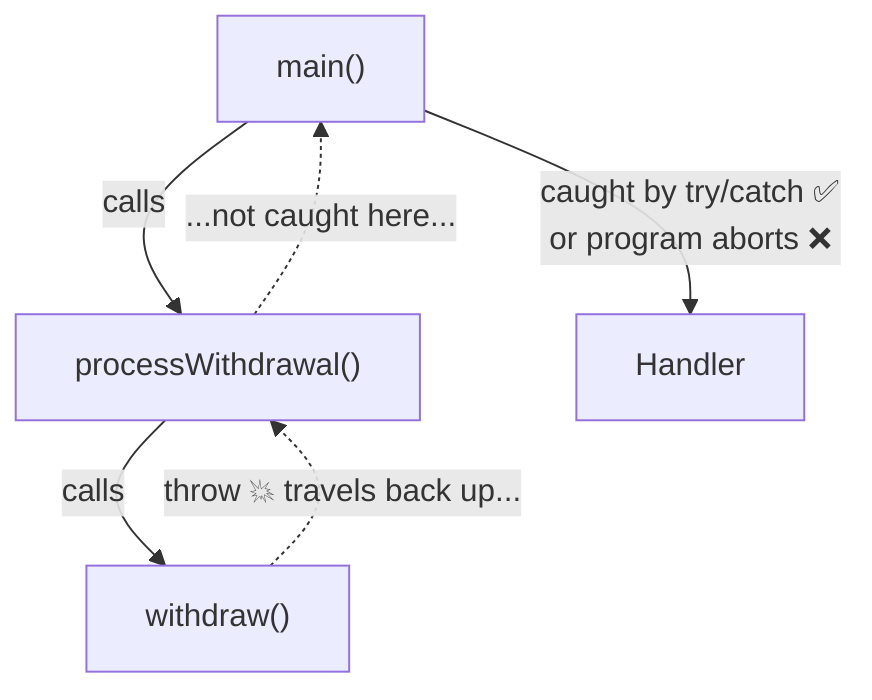
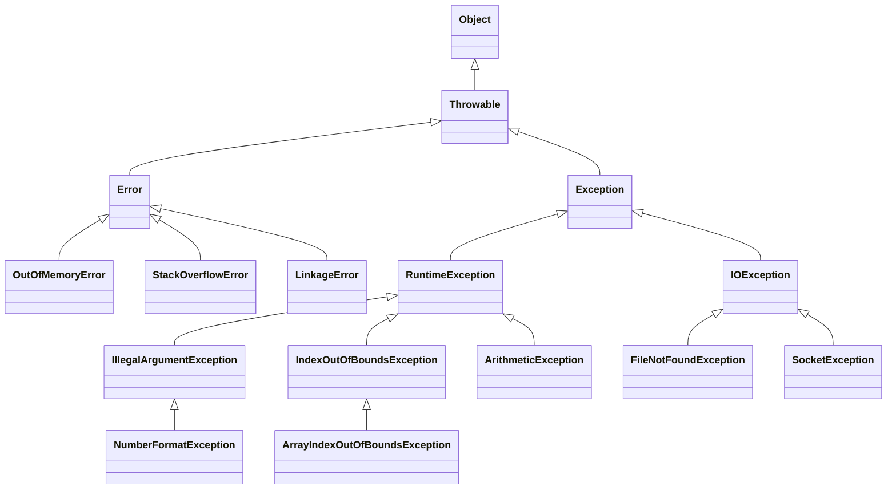

[[Session 8 - Enums.pdf]]
[[Session 8 - Error Handling with Exceptions.pdf]]

---

# Enums & Exceptions

> [!summary] TL;DR
> 
> - An **enum** is a type with a **fixed, finite set of values** (weekdays, planets, compass points). Enums can have fields, constructors and methods.
> - Programs go wrong through **misuse**, **unreliable resources**, or **bugs**. The first two are often recoverable; bugs aren't.
> - Java reports errors with **exceptions**: `throw` aborts a method, `try/catch` handles the problem.
> - **Checked** exceptions (subclass of `Exception`) must be caught or declared; **unchecked** (subclass of `RuntimeException`) don't have to be.

Previous: [[OOP Lecture 7 - Software Testing]]

---

# Part 1 – Enums

## 1. Enumerations

Lots of data comes in **finitely many variants**:

- Primary colors: Red, Green, Blue
- Operating systems: Windows, Linux, Mac
- Compass points: North, East, South, West
- Card ranks: Ace, King, Queen, …
- Weekdays: Monday, Tuesday, …
- Planets: Mercury, Venus, Earth, Mars, Jupiter, Saturn, Uranus, Neptune _(Pluto is not a planet 💔)_

## 2. Why Not Interfaces and Classes?

```java
public interface Planet {
    String getName();
    double getMass();
}

public class Mercury implements Planet { // one class per planet...
    public String getName() { ... }
    public double getMass() { ... }
}

public class Venus implements Planet {   // ...and again...
    public String getName() { ... }
    public double getMass() { ... }
}
```

> [!question] Problems
> 
> - Lots of **boilerplate**: one class per value.
> - Nothing stops someone from writing `class Pluto implements Planet` or creating `new Mercury()` many times.
> - The set of planets isn't **fixed** or easy to list.

> [!bug] Slide error The slide writes `class Mercury extends Planet`, but `Planet` is an interface, so it must be `implements`.

## 3. A Simple Enum

```java
public enum Day {
    MONDAY, TUESDAY, WEDNESDAY, THURSDAY, FRIDAY, SATURDAY, SUNDAY
}
```

```java
Day d = Day.FRIDAY;

switch (d) {
    case MONDAY:
        System.out.println("Monday! Bummer!");
        break;                       // without break, execution FALLS THROUGH to the next case
    case FRIDAY:
        System.out.println("Aww yeah!");
        break;
    default:
        System.out.println("Just another day.");
}
```

> [!bug] Slide errors
> 
> - `switch (r)` should be `switch (d)`: there's no variable `r`.
> - The cases have no `break`, so after `"Aww yeah!"` it would keep running the code of every case below it.

> [!tip] Modern switch (Java 14+): no fall-through, no `break`
> 
> ```java
> switch (d) {
>     case MONDAY -> System.out.println("Monday! Bummer!");
>     case FRIDAY -> System.out.println("Aww yeah!");
>     case SATURDAY, SUNDAY -> System.out.println("Weekend!");
>     default -> System.out.println("Just another day.");
> }
> 
> // It can also produce a value:
> String mood = switch (d) {
>     case FRIDAY -> "happy";
>     case MONDAY -> "sad";
>     default -> "meh";
> };
> ```

## 4. Enums with Fields, Constructors and Methods

Enums are **classes**: each value is an object, and you can attach data.

```java
enum Planet {
    MERCURY(1),   // calls the constructor with position = 1
    VENUS(2),
    EARTH(3),
    MARS(4);      // semicolon needed before fields/methods

    private int position;           // each value has its own position

    Planet(int position) {          // enum constructors are always private
        this.position = position;
    }

    public int getPosition() {
        return position;
    }
}
```

```java
Planet p = Planet.EARTH;

switch (p) {
    case EARTH:
        int pos = p.getPosition();
        System.out.println("It's earth! Our Homeworld.");
        System.out.println("Planet number " + pos + ".");
        break;                                   // ← missing on the slide!
    default:
        System.out.println("It is not earth.");
}
```

> [!warning] Exam trap: fall-through The slide's version has no `break`, so for `EARTH` it prints the Earth messages **and then** "It is not earth." too.

> [!info] Multiple fields work too
> 
> ```java
> enum Planet {
>     MERCURY(3.30e23, 2.44e6),
>     EARTH(5.97e24, 6.37e6);
> 
>     private final double mass;   // kg
>     private final double radius; // m
> 
>     Planet(double mass, double radius) {
>         this.mass = mass;
>         this.radius = radius;
>     }
> }
> ```

## 5. Built-in Enum Features (bonus)

|Feature|Example|Result|
|---|---|---|
|All values|`Day.values()`|Array of all 7 days|
|From a string|`Day.valueOf("FRIDAY")`|`Day.FRIDAY` (throws if no match)|
|Name|`Day.FRIDAY.name()`|`"FRIDAY"`|
|Position in declaration|`Day.FRIDAY.ordinal()`|`4` (starts at 0)|
|Compare|`d == Day.FRIDAY`|`==` is safe for enums|

```java
for (Day day : Day.values()) {  // loop over every value
    System.out.println(day);
}
```

> [!tip] Why enums beat strings or ints `String day = "Firday";` compiles fine with a typo. `Day day = Day.FIRDAY;` **doesn't**: the compiler catches it.

---

# Part 2 – Error Handling with Exceptions

## 6. How Can Programs Go Wrong?

|Cause|Examples|Recoverable?|How to handle|
|---|---|---|---|
|**Incorrect use**|File doesn't exist, domain doesn't exist, no permission|✅ Yes|Explain the problem, ask the user to fix it|
|**Unreliable resources**|Network down, disk full, out of memory|⚠️ Often|Retry later, or ask the user to act|
|**Protocol violations (bugs)**|Memory never freed, freed memory accessed, divide by zero|❌ Almost never|The **code** must be fixed; save data and exit|

## 7. How Can We Report an Error?

We call a method. Did it go well?

|Approach|Used in|Notes|
|---|---|---|
|**Global variable** with an error code|C|Old school. **Avoid.**|
|**Return an error code**|C and many others|Awkward if you also need to return a value (e.g. `-1` = error, anything else = result)|
|**Return a success/failure structure**|Functional languages (Scala, Haskell, OCaml)|Error is part of the return type|
|**Exceptions** (redirect control flow)|Java, C#, most industry languages|← this lecture|

## 8. Exceptions

A **control-flow mechanism** for abnormal situations.

- You **throw** and **catch** exceptions.
- An exception is an **object** (an instance of a class).

### Throwing

- `throw` immediately aborts execution, like `return`.
- But `return` exits **only the current method**; `throw` keeps exiting methods **until something catches it**.

### Catching

- Execution continues **from where the exception is caught**.
- The code that catches it is the **exception handler**.
- If nothing catches it, it reaches `main` and the **program aborts**.



## 9. Throwing an Exception

```java
public class BankAccount {
    private int balance;

    public void withdraw(int amount) {
        if (amount <= 0) {
            String msg = "Amount must be positive.";
            throw new IllegalArgumentException(msg); // stop here, report why
        }
        if (amount > balance) {
            String msg = "Amount must not exceed balance.";
            throw new IllegalArgumentException(msg);
        }
        balance = balance - amount;                   // only reached if all checks pass
    }
}
```

> [!note] Slide detail The slide checks `amount >= balance`, which also rejects withdrawing **exactly** your whole balance. `amount > balance` is probably what's intended.

## 10. Try-Catch

```java
public static void main(String[] args) {
    Scanner scanner = new Scanner(System.in);
    BankAccount account = new BankAccount(100);

    while (true) {
        System.out.println("Enter an amount to withdraw:");
        int amount = scanner.nextInt();

        try {
            account.withdraw(amount);              // code that might throw
        } catch (IllegalArgumentException e) {     // runs only if that exception is thrown
            System.out.println("Something went wrong: " + e.getMessage());
        }
        // execution continues here either way → the program doesn't crash
    }
}
```

> [!tip] `e.getMessage()` Returns the message you passed when creating the exception, e.g. `"Amount must be positive."`

### `finally` (bonus)

Runs **whether or not** an exception happened: good for cleanup.

```java
try {
    account.withdraw(amount);
} catch (IllegalArgumentException e) {
    System.out.println("Failed: " + e.getMessage());
} finally {
    System.out.println("Transaction attempt logged."); // always runs
}
```

## 11. Custom Exceptions

Make your own exception classes by **extending** an existing one. They can carry **extra data**.

```java
public class NegativeAmountException extends RuntimeException {
    public NegativeAmountException() { }
}

public class InsufficientFundsException extends RuntimeException {
    private int deficit;                     // how much money is missing

    public InsufficientFundsException(int deficit) {
        super("Short by " + deficit);        // bonus: also sets getMessage()
        this.deficit = deficit;
    }

    public int getDeficit() {
        return deficit;
    }
}
```

```java
public void withdraw(int amount) {
    if (amount <= 0) {
        throw new NegativeAmountException();
    }
    if (amount > balance) {
        int deficit = amount - balance;
        throw new InsufficientFundsException(deficit);
    }
    balance = balance - amount;
}
```

> [!tip] Why custom exceptions? The **type** says what went wrong (so callers can react differently), and fields like `deficit` give details, instead of parsing a message string.

## 12. Catching Multiple Exceptions

```java
try {
    account.withdraw(amount);
} catch (NegativeAmountException e) {
    System.out.println("Amount cannot be negative!");
} catch (InsufficientFundsException e) {
    System.out.println("You are short: " + e.getDeficit());
}
```

> [!warning] Order matters (bonus) Java checks `catch` blocks **top to bottom** and uses the first match. Put **specific** exceptions before **general** ones:
> 
> ```java
> catch (InsufficientFundsException e) { ... } // specific first
> catch (RuntimeException e) { ... }           // general last
> ```
> 
> The other way round, the compiler complains the specific one is unreachable.

> [!tip] Same handling for several types
> 
> ```java
> catch (NegativeAmountException | InsufficientFundsException e) {
>     System.out.println("Invalid withdrawal.");
> }
> ```

## 13. Uncaught Exceptions & Stack Traces

Uncaught exceptions travel up to `main` and **abort the program**, printing a **stack trace**: the list of methods that were running when it happened.

```
Exception in thread "main" NegativeAmountException
    at BankAccount.withdraw(BankAccount.java:11)   ← where it was thrown
    at Main.main(Main.java:13)                     ← who called that
```

> [!tip] Reading a stack trace Read **top to bottom**: the top line is the exception type, the first `at` is where it was thrown, each line below is the caller. Click the file/line link in IntelliJ to jump straight there. Real traces are often much longer, so look for the first line that mentions **your own** code.

## 14. Checked vs. Unchecked Exceptions

||**Checked**|**Unchecked**|
|---|---|---|
|Superclass|`Exception`|`RuntimeException` (and `Error`)|
|Must be caught or declared?|✅ **Yes**: compiler enforces it|❌ No, optional|
|Typical use|Expected external problems (file not found, network)|Programming bugs, invalid arguments|
|Examples|`IOException`, `FileNotFoundException`|`IllegalArgumentException`, `NullPointerException`, `ArithmeticException`|

### A checked exception in practice

```java
public class InsufficientFundsException extends Exception { // Exception → checked
    private int deficit;
    public InsufficientFundsException(int deficit) { this.deficit = deficit; }
    public int getDeficit() { return deficit; }
}

// "throws" in the signature: warns every caller this can happen
public void withdraw(int amount) throws InsufficientFundsException {
    if (amount > balance) {
        int deficit = amount - balance;
        throw new InsufficientFundsException(deficit);
    }
    balance = balance - amount;
}
```

Every caller **must** now either handle it…

```java
try {
    account.withdraw(500);
} catch (InsufficientFundsException e) {
    System.out.println("Short by " + e.getDeficit());
}
```

…or **re-throw** it by declaring `throws` too:

```java
public void payRent() throws InsufficientFundsException {
    account.withdraw(500); // not handled here: passed on to whoever calls payRent()
}
```

> [!question] The checked exception controversy
> 
> - Programmers dislike being told what to do.
> - Libraries with lots of checked exceptions are painful to use.
> - Widely considered a **design mistake**.
> - That's why **C#** (and C++) don't have them.

## 15. The Exception Hierarchy



|Branch|Meaning|Checked?|
|---|---|---|
|`Error`|Serious JVM problems (out of memory, stack overflow). **Don't catch.**|Unchecked|
|`RuntimeException` and subclasses|Usually bugs or bad arguments|Unchecked|
|Other `Exception` subclasses (e.g. `IOException`)|Expected external failures|**Checked**|

> [!info] Catching a superclass catches all its subclasses `catch (IOException e)` also catches `FileNotFoundException` and `SocketException`. This is [[OOP Lecture 3 - Interfaces and Inheritance#3. Subtyping & Polymorphism|subtyping]] in action.

> [!tip] Common ones you'll meet
> 
> - `NullPointerException`: called a method on `null`
> - `ArrayIndexOutOfBoundsException` / `IndexOutOfBoundsException`: bad index
> - `NumberFormatException`: `Integer.parseInt("abc")`
> - `ArithmeticException`: integer division by zero
> - `StackOverflowError`: recursion that never stops

---

## Key Terms

- **Enum** – type with a fixed set of named values
- **`values()` / `valueOf()` / `ordinal()`** – built-in enum helpers
- **Fall-through** – a `switch` case without `break` continuing into the next case
- **Exception** – object representing an abnormal situation
- **`throw`** – aborts the current method and sends an exception up the call stack
- **`try` / `catch`** – run code and handle exceptions it throws
- **Exception handler** – the `catch` block that handles an exception
- **`finally`** – block that always runs after `try`/`catch`
- **Custom exception** – your own class extending `Exception` or `RuntimeException`
- **Stack trace** – list of methods on the call stack when the exception occurred
- **Checked exception** – subclass of `Exception`; must be caught or declared with `throws`
- **Unchecked exception** – subclass of `RuntimeException`; handling is optional
- **`throws`** – declares in a method signature that it may throw a checked exception
- **`Throwable`** – root of all exceptions and errors