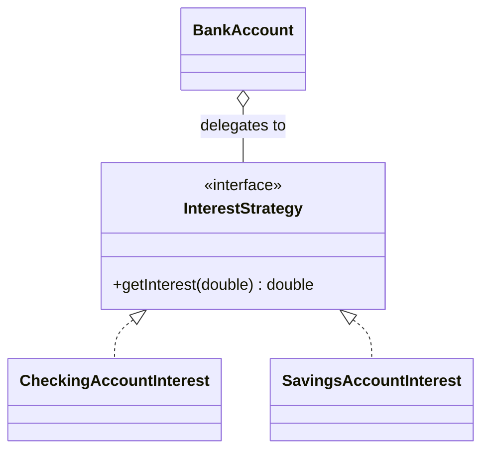
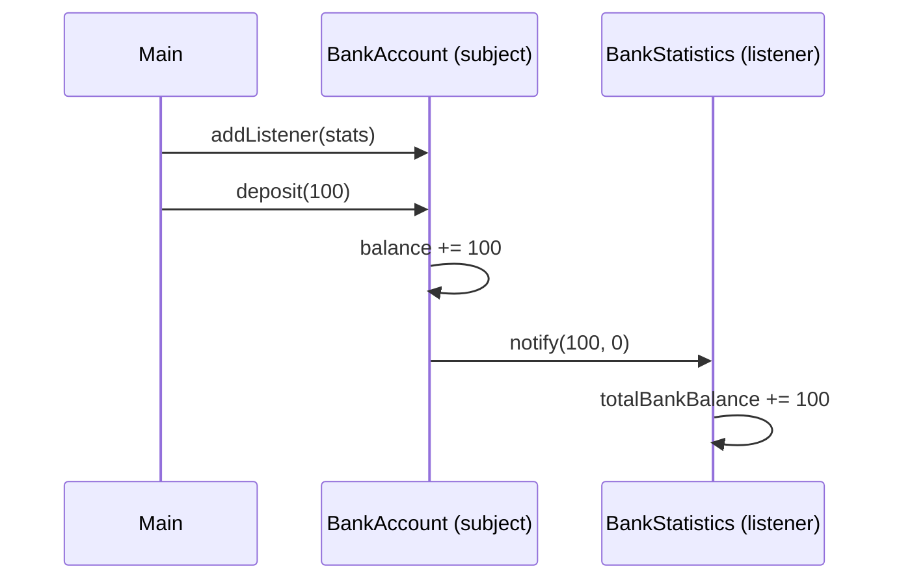
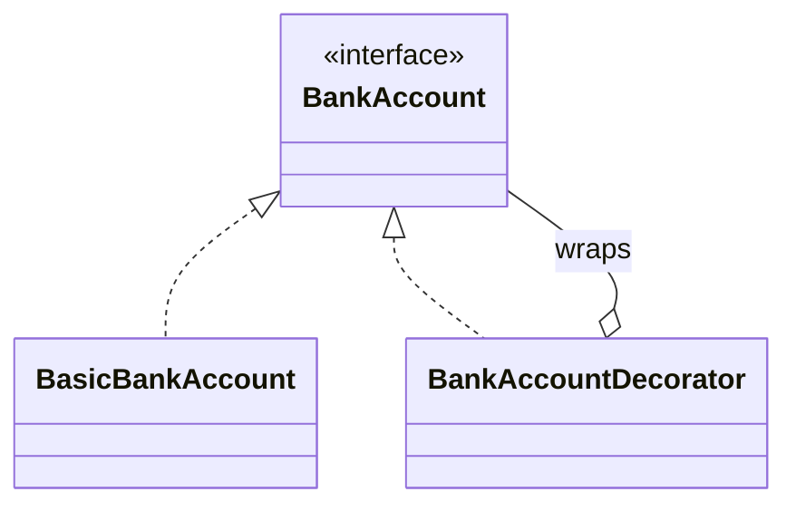

[[Session 9 - Design Patterns I.pdf]]

---

# Design Patterns

> [!summary] TL;DR
> 
> - A **design pattern** is a battle-tested blueprint for a recurring problem. Each has a **name**, an **intent**, and solves a **specific problem**, so patterns double as a shared vocabulary.
> - **Strategy**: move behavior that varies into an interface and pass in the implementation.
> - **Observer**: let other objects register listeners and get notified when something changes.
> - **Decorator**: wrap an object in another object with the same interface to add behavior.
> - **Builder**: construct complex objects step by step with chained setters, then `build()`.

Previous: [[Lecture 8]]

---

## 1. What is a Design Pattern?

**A blueprint or schematic to solve a re-occurring problem**: a common, battle-tested solution to a frequently occurring problem.

Each pattern has:

- a **name**
- an **intent**
- a **specific problem** it solves

> [!tip] Patterns are vocabulary Saying "let's use a Strategy here" communicates a whole design in two words. (Unfortunately it's not always an exact science: people sometimes mean slightly different things by the same name.)

---

## 2. Catalogue of Patterns

The three classic categories (from the "Gang of Four" book). One-line descriptions are mine; the slides only list the names.

### Creational: _how objects are created_

|Pattern|Idea|
|---|---|
|**Abstract Factory**|An object that creates _families_ of related objects without naming their concrete classes|
|**Builder** ⭐|Build a complex object step by step|
|**Factory Method**|A method that decides which subclass to instantiate|
|**Singleton**|Guarantee a class has exactly one instance|

### Structural: _how objects are combined_

|Pattern|Idea|
|---|---|
|**Adapter**|Make a class with the wrong interface fit the interface you need|
|**Composite**|Treat a group of objects the same way as a single object (trees)|
|**Decorator** ⭐|Wrap an object to add behavior, keeping the same interface|
|**Proxy**|A stand-in that controls access to another object|

### Behavioral: _how objects interact_

|Pattern|Idea|
|---|---|
|**Command**|Turn a request/action into an object (undo, queues)|
|**Iterator**|Step through a collection without knowing its internals (see [[OOP Lecture 6 - Collections, Object Class, Generics\|Lecture 6]])|
|**Memento**|Save and restore an object's state|
|**Null Object**|A "do nothing" object instead of `null`|
|**Observer** ⭐|Notify listeners when something changes|
|**State**|An object changes behavior when its internal state changes|
|**Strategy** ⭐|Swap an algorithm/behavior by passing in an object|
|**Visitor**|Add operations to a class hierarchy without changing it|

⭐ = covered in detail below. And many, many more…

---

## 3. STRATEGY Pattern

> [!important] Strategy **Problem:** A class should vary its behavior depending on circumstance, but it shouldn't be responsible for the concrete behavior itself. **Solution:**
> 
> 1. Abstract the behavior into a **Strategy interface**.
> 2. Give the class an instance of the Strategy.
> 3. Implement the varying behavior by **delegating** to the Strategy object.

### Motivation: the "before"

```java
public enum AccountType { CHECKING, SAVING }

public class BankAccount {
    private double balance;
    private AccountType type;

    public BankAccount(double balance, AccountType type) {
        this.balance = balance;
        this.type = type;
    }

    public void accrueInterest() {
        switch (type) {                                      // behavior hard-coded here
            case CHECKING: this.balance = this.balance * 1.000001; break;
            case SAVING:   this.balance = this.balance * 1.05;     break;
        }
    }
}
```

> [!question] What's wrong? Every new account type (student, pension, business…) means **editing `BankAccount`** and growing the `switch`. The class knows too much about interest rules.

### Step 1: The Strategy interface and implementations

```java
public interface InterestStrategy {
    double getInterest(double balance); // "given a balance, how much interest?"
}

public class CheckingAccountInterest implements InterestStrategy {
    public double getInterest(double balance) {
        return balance * 0.000001;
    }
}

public class SavingsAccountInterest implements InterestStrategy {
    public double getInterest(double balance) {
        return balance * 0.05;
    }
}
```

### Step 2: Delegate the behavior

```java
public class BankAccount {
    private double balance;
    private InterestStrategy interestStrategy; // "has-a" strategy

    public BankAccount(double balance, InterestStrategy interestStrategy) {
        this.balance = balance;
        this.interestStrategy = interestStrategy;
    }

    public void accrueInterest() {
        // BankAccount doesn't know HOW interest is calculated: it just asks
        this.balance = this.balance + interestStrategy.getInterest(this.balance);
    }
}
```

### Using it

```java
BankAccount savings  = new BankAccount(1000, new SavingsAccountInterest());
BankAccount checking = new BankAccount(1000, new CheckingAccountInterest());

// A brand-new type without touching BankAccount, written as a lambda:
BankAccount student = new BankAccount(1000, balance -> balance * 0.02);
```



> [!info] You've used Strategy already `Collections.sort(list, comparator)`: the `Comparator` **is** a strategy for ordering. See [[OOP Lecture 6 - Collections, Object Class, Generics#8. Comparator<T>|Comparator]].

> [!tip] Bonus: swap at run-time Add `setInterestStrategy(...)` and an account can change type (e.g. checking → savings) without creating a new object.

---

## 4. OBSERVER Pattern

> [!important] Observer **Problem:** We want to be notified whenever something changes on a **subject** object, e.g.
> 
> - a button is pressed
> - a key is pressed
> - a network request completes
> 
> **Solution:**
> 
> 1. Introduce a **listener interface**: the method to call when the event happens.
> 2. Let other objects **register** listeners on the subject.
> 3. When the event happens, the subject **calls all its listeners**.

### Step 1: Listener interface

```java
public interface AccountListener {
    void notify(double newBalance, double oldBalance); // called on every balance change
}
```

### Step 2: Subject (the thing being watched)

```java
public class BankAccount {
    private double balance;
    private List<AccountListener> listeners = new ArrayList<>(); // everyone who wants updates

    public void addListener(AccountListener listener) {
        listeners.add(listener);                   // "subscribe"
    }

    public void deposit(double amount) {
        double oldBalance = this.balance;
        this.balance = this.balance + amount;
        for (AccountListener listener : this.listeners) {
            listener.notify(this.balance, oldBalance); // tell every listener
        }
    }
}
```

### Step 3: A listener (observer)

```java
public class BankStatistics implements AccountListener {
    double totalBankBalance;

    public BankStatistics(double totalBankBalance) {
        this.totalBankBalance = totalBankBalance;
    }

    @Override
    public void notify(double newBalance, double oldBalance) {
        double difference = newBalance - oldBalance;
        totalBankBalance += difference;            // keep the bank-wide total up to date
    }
}
```

### Wiring it up

```java
BankAccount account = new BankAccount();
BankStatistics stats = new BankStatistics(0);

account.addListener(stats);                       // stats now watches the account
account.addListener((n, o) ->                      // listeners can be lambdas too
    System.out.println("Balance: " + o + " → " + n));

account.deposit(100);                              // both listeners are notified
```



> [!tip] Why it's useful `BankAccount` doesn't know or care **who** is listening (statistics, logging, a UI, an email service…). New listeners can be added without changing `BankAccount`: **loose coupling**.

> [!note] Slide details
> 
> - `new ArrayList()` on the slide is a raw type; write `new ArrayList<>()` (see [[OOP Lecture 6 - Collections, Object Class, Generics#17. Parametric Polymorphism (Generics)|generics]]).
> - Naming the method `notify` compiles (it overloads `Object.notify()`, which takes no arguments), but it's easy to confuse with the threading method. A name like `onBalanceChanged` is clearer.
> - In a full version, `withdraw` should notify listeners too, or the statistics drift out of sync.

---

## 5. DECORATOR Pattern

> [!important] Decorator **Problem:** We want to add behavior to an existing class, e.g.
> 
> - **logging** some operations
> - enforcing extra **security**
> - **caching** computations (e.g. `BufferedReader`)
> 
> **Solution:**
> 
> 1. Refactor the class's API into an **interface**.
> 2. Let the original class implement it.
> 3. Write a **Decorator** class that also implements the interface and holds a reference to an original instance.
> 4. The decorator **forwards** every method to the original, and **intercepts** some to add behavior.

### Step 1: Existing class

```java
public class BankAccount {
    public String getOwner() { ... }
    public double getBalance() { ... }
    public void deposit(double amount) { ... }
    public void withdraw(double amount) { ... }
    public void accrueInterest() { ... }
    public void transferTo(BankAccount otherAccount) { ... }
}
```

### Step 2: Turn the API into an interface

```java
public interface BankAccount {
    String getOwner();
    double getBalance();
    void deposit(double amount);
    void withdraw(double amount);
    void accrueInterest();
    void transferTo(BankAccount otherAccount);
}

// The original class gets a new name and implements the interface
public class BasicBankAccount implements BankAccount { ... }
```

### Step 3: The decorator

```java
public class BankAccountDecorator implements BankAccount {
    private BankAccount account; // the wrapped ("decorated") object

    public BankAccountDecorator(BankAccount account) {
        this.account = account;
    }

    // Plain forwarding: just pass the call through
    public String getOwner()      { return account.getOwner(); }
    public double getBalance()    { return account.getBalance(); }
    public void withdraw(double a){ account.withdraw(a); }
    public void accrueInterest()  { account.accrueInterest(); }

    // Intercepted: extra behavior (LOGGING), then forward
    public void deposit(double amount) {
        System.out.println("Deposit: " + amount);
        account.deposit(amount);
    }

    // Intercepted: extra behavior (SECURITY), only forward if allowed
    public void transferTo(BankAccount otherAccount) {
        if (account.getOwner().equals(otherAccount.getOwner())) {
            account.transferTo(otherAccount);
        }
    }
}
```

### Using it

```java
BankAccount plain     = new BasicBankAccount(/* ... */);
BankAccount decorated = new BankAccountDecorator(plain); // same type: BankAccount!

decorated.deposit(50); // prints "Deposit: 50.0", then deposits
```



> [!bug] Slide errors
> 
> - The slide's decorator doesn't implement `withdraw` or `accrueInterest`, so it **wouldn't compile**: a class must implement _every_ interface method. The version above adds them.
> - After turning `BankAccount` into an interface, the original class needs a **different name** (e.g. `BasicBankAccount`); two types can't share a name in the same package.
> - `transferTo` silently does nothing for a different owner. Throwing an exception would be better (see [[OOP Lecture 8 - Enums and Exceptions]]).

> [!tip] Decorators stack Because a decorator _is_ a `BankAccount`, you can wrap a wrapper:
> 
> ```java
> BankAccount acc = new LoggingAccount(new SecureAccount(new BasicBankAccount()));
> ```
> 
> Java I/O works exactly like this: `new BufferedReader(new FileReader("data.txt"))`.

> [!info] Decorator vs. inheritance You could subclass `BasicBankAccount` to add logging, but then logging + security needs yet another subclass, and so on. Decorators **combine freely** at run-time. This is the composition-over-inheritance idea from [[OOP Lecture 4 - Object Oriented Design#5. What We Should Not Do|Lecture 4]].

---

## 6. BUILDER Pattern

> [!important] Builder **Problem:** We want to construct a **complex object**:
> 
> - many fields
> - some optional (with defaults), some required
> - some with complex invariants
> - one huge constructor (or dozens of overloaded ones) is verbose and error-prone
> 
> **Solution:** A separate **Builder** object constructs the complex object **piece by piece**.

### The complex class

```java
public class BankAccount {
    private String firstName;
    private String middleName;
    private String lastName;
    private String socialSecurity;
    private String streetAddress;
    private String streetNumber;
    private String city;
    private String country;
    private double balance;
    private boolean allowOverdraft;
    private double borrowRate;
    private double interestRate;
    private Date accountCreated;
    private Date accountChanged;
    private Date accountArchived;
    private List<Transaction> transactions;
    // ...
}
```

> [!question] Why not just a constructor? `new BankAccount("Magnus", null, "Madsen", "...", null, null, "Aalborg", "DK", 0, false, 0.1, 0.02, ...)`: which argument is which? Easy to swap two `String`s or two `double`s and the compiler won't notice.

### The builder

```java
public class BankAccountBuilder {
    private String firstName;
    private String middleName;
    private String lastName;

    public BankAccountBuilder setFirstName(String firstName) {
        this.firstName = firstName;
        return this;                   // returning "this" enables chaining
    }

    public BankAccountBuilder setMiddleName(String middleName) {
        this.middleName = middleName;
        return this;
    }

    public BankAccountBuilder setLastName(String lastName) {
        this.lastName = lastName;
        return this;
    }

    public BankAccount build() {
        // good place to check required fields and invariants (bonus)
        if (firstName == null || lastName == null) {
            throw new IllegalStateException("First and last name are required");
        }
        return new BankAccount(firstName, middleName, lastName /* , ... */);
    }
}
```

### Using it

```java
BankAccountBuilder builder = new BankAccountBuilder();
builder.setFirstName("Magnus")     // each setter returns the builder...
       .setLastName("Madsen");     // ...so calls can be chained (fluent API)

BankAccount account = builder.build(); // middleName was never set → stays null/default
```

> [!tip] Why it's nice
> 
> - **Readable**: every value is labelled by its setter name.
> - **Optional fields**: just don't call that setter.
> - **Validation in one place**: `build()` checks everything before the object exists.
> - The resulting object can be **immutable** (no setters on `BankAccount` itself).

> [!info] Where you'll see it `StringBuilder` (`sb.append("a").append("b")`), `HttpRequest.newBuilder()`, Spring's `RestClient` chains ([[OOP Lecture 5 - Spring Boot#5c. Calling an _external_ API from Spring (backend)|Lecture 5]]).

---

## 7. Comparison

|Pattern|Category|Problem|Key mechanism|
|---|---|---|---|
|**Strategy**|Behavioral|Behavior varies; class shouldn't own it|Pass in an object implementing an interface; **delegate**|
|**Observer**|Behavioral|React when something changes|Subject keeps a **list of listeners** and calls them|
|**Decorator**|Structural|Add behavior to an existing class|**Wrap** an object with the same interface; forward + intercept|
|**Builder**|Creational|Constructing objects with many fields|Chained setters returning `this`, then `build()`|

> [!important] Common thread All four lean on **interfaces** and **composition** (objects holding other objects) rather than deep inheritance, exactly the advice from [[OOP Lecture 4 - Object Oriented Design]].

---

## 8. Further Reading

- _Design Patterns: Elements of Reusable Object-Oriented Software_: Gamma, Helm, Johnson, Vlissides (the "Gang of Four")
- _Head First Design Patterns_: Freeman & Freeman (beginner-friendly)
- _Patterns of Enterprise Application Architecture_: Martin Fowler

---

## Key Terms

- **Design pattern** – reusable, battle-tested solution to a recurring design problem
- **Creational / Structural / Behavioral** – patterns about creating / combining / interacting objects
- **Delegation** – an object handing work to another object it holds
- **Strategy** – interchangeable behavior passed in as an object
- **Observer / listener** – object notified when a subject changes
- **Subject** – the object being observed
- **Loose coupling** – objects depend on each other as little as possible
- **Decorator** – wrapper with the same interface that adds behavior
- **Forwarding** – passing a method call straight through to the wrapped object
- **Builder** – helper object that constructs a complex object step by step
- **Fluent API / method chaining** – methods returning `this` so calls can be chained